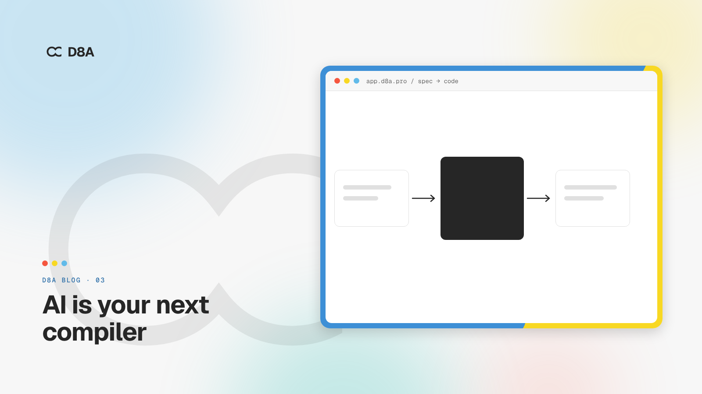
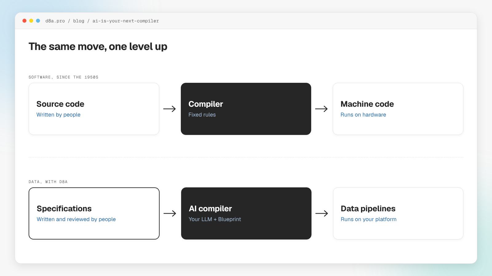
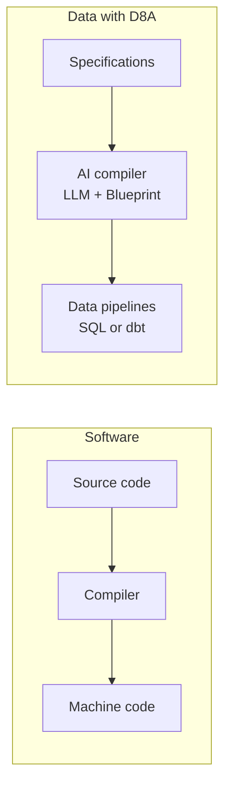
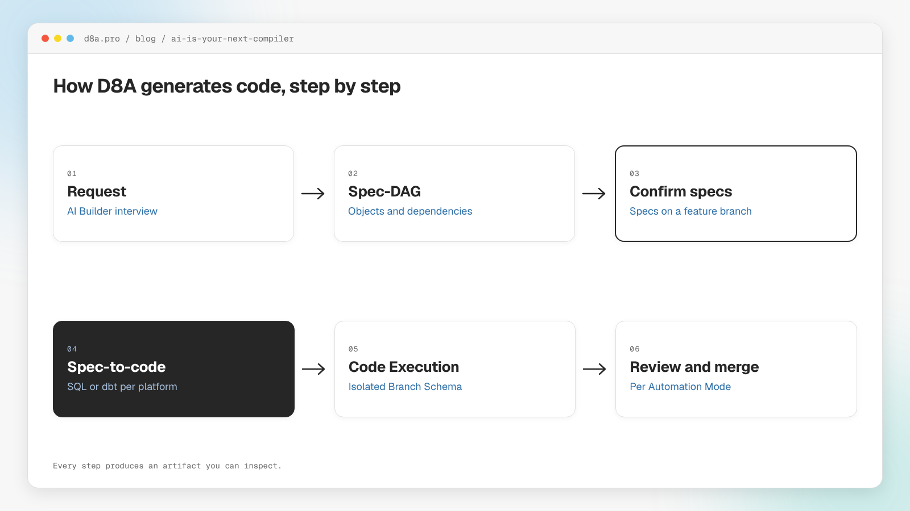
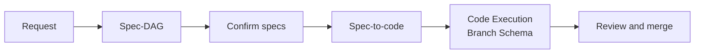

# AI is your next compiler: AI code generation for data pipelines

Nobody reviews the assembly their compiler produces. They review the source.
AI code generation for data pipelines is heading the same way: you write and review specifications, and AI compiles them into the SQL or dbt your platform runs.

> **TL;DR**
> - A compiler turns source code into machine code using fixed rules. D8A uses AI to turn specifications into data pipelines using your architecture rules.
> - Generation follows a fixed path: request, Spec-DAG, confirmed specs, generated code, execution in an isolated schema, review and merge.
> - You choose the model, and you set how much the AI may do on its own at each step. Human in command. Always.

<!-- IMAGE PROMPT: Abstract hero for "AI is your next compiler". Light canvas #F7F7F7, soft blurred orbs in sky, teal, yellow and faint red. Stroke-only infinity watermark at 8% ink. Right: white window with chrome dots and mono URL "app.d8a.pro / spec → code", inside an abstract compiler motif: white card, arrow, large ink #262626 square, arrow, white card, with placeholder lines. Hard-stop color frame sky-deep to yellow at 115 degrees. Mono eyebrow "D8A blog · 03", Geist bold headline "AI is your next compiler". No robots, no brains, no people, no purple. 1600x900. -->

*Specs go in. Platform-native code comes out.*

## Why compare AI code generation to a compiler?

In the 1950s, programmers wrote machine instructions by hand. Compilers changed the job: engineers wrote in a higher-level language, and a program translated it. The value moved up a level, to the source code.

Data engineering has not had that shift yet. Teams still hand-write most transformations in SQL or PySpark. The specification, when it exists, is a document next to the code instead of the input to it.

D8A treats the specification as source code and AI as the compiler. The analogy has limits, and we will get to them. It explains well where the value moves: to the spec and the architecture rules, which people write and review.

<!-- IMAGE PROMPT: Branded analogy schematic on a white window card with chrome dots, two rows separated by a dashed hairline. Top row labelled "Software, since the 1950s": three cards joined by ink arrows: "Source code" (written by people), "Compiler" (ink fill, fixed rules), "Machine code" (runs on hardware). Bottom row labelled "Data, with D8A": "Specifications" (written and reviewed by people), "AI compiler" (ink fill, your LLM + Blueprint), "Data pipelines" (runs on your platform). Geist type, mono row labels, canvas #F7F7F7, no purple. -->

*Same move, one level up: people own the source, a translator produces what runs.*

## What does the AI compiler read?

A classic compiler reads source code and a target. D8A's generation reads three inputs.

**The specification.** One Markdown file per data object with description, grain, columns, column types, transformation logic and lineage. [Specs are the new code](./specs-are-the-new-code.md) covers what goes in them.

**The architecture.** Your Data Architecture, drawn on the Blueprint canvas, declares data platforms, layers, patterns and feeds. Each layer and pattern carries Agentic Layer Instructions: spec instructions, code instructions, naming conventions and path templates. Generation stacks them in order, platform first, then layer, then pattern. You can start from a Marketplace blueprint such as Medallion, Kimball star, Data Vault or dbt-oriented, or import instructions from your own documents.

**The target.** Each Data Platform has a Code Format: plain SQL or dbt. D8A also knows the platform's dialect and can generate Power BI semantic models and Fabric Data Factory pipelines where configured.

## How AI code generation for data pipelines works in D8A, step by step

Generation in D8A is a sequence of reviewable steps, each with a clear output.

<!-- IMAGE PROMPT: Branded flow diagram on a white window card with chrome dots, two rows of three cards joined by ink arrows. Row one: "01 Request" (plain language, AI Builder interview), "02 Spec-DAG" (objects and dependencies), "03 Confirm specs" (specs on a feature branch, highlighted). Row two: "04 Spec-to-code" (ink fill, SQL or dbt per platform), "05 Code Execution" (isolated Branch Schema), "06 Review and merge" (human approval per Automation Mode). Geist type, mono step tags, canvas #F7F7F7, no purple. -->

*Six steps, each with an artifact you can inspect.*

1. **Request.** A user starts a new request. The AI Builder interviews them in business terms.
2. **Spec-DAG.** D8A drafts the set of data objects needed and how they depend on each other.
3. **Confirm specs.** The team reviews the draft and commits per-object specifications to a feature branch, linked to a Work Item.
4. **Spec-to-code.** D8A generates code for each object. For plain SQL this is an idempotent, additive create-and-load script. For dbt it is a model plus a YAML file with tests and descriptions.
5. **Code Execution.** The code runs on your platform. dbt builds go into a per-branch Branch Schema in an isolated runner, so you test without touching production.
6. **Review and merge.** Humans approve according to the Automation Mode set for that column of the board.

When a run fails, Fix with AI proposes a correction. Renames and drops go through a separate, reviewed migration step.

## Where the compiler analogy breaks

A compiler is deterministic. Give it the same source twice and you get the same output. An LLM is not, and pretending otherwise would be dishonest.

D8A handles this in three ways. Code is checked against the spec, and a freshness badge flags drift. Generated code lands on a branch, runs in isolation and goes through review before merge. And Automation Mode lets you choose, per step and per work item, whether the agent acts alone, acts with human validation, or leaves the step to a human.

The result is closer to a compiler with a code review built in. The source stays authoritative, and a person signs off on what reaches production. Human in command. Always.

## You choose the compiler

You can switch compilers without rewriting your source code. D8A keeps that property for models.

An LLM Connection can use OpenRouter, Anthropic, Azure AI Foundry, Amazon Bedrock, Google AI, Snowflake Cortex or Databricks model serving, with your own keys. Workflows reference Model Roles instead of model names, so changing models is a configuration change. For teams that care where prompts are processed, that choice is part of [running a sovereign data stack](./sovereign-data-stack.md).

## What this means for your team

When AI handles translation, engineers spend less time on boilerplate and more on architecture, instructions and review. It removes process work, not engineers. The effect on capacity and consistency is the subject of [what D8A changes for your data team](./data-team-capacity.md). [NEED: measured time from request to merged code, before and after D8A]

> [!NOTE]
> **Key takeaway:** Treat specs as source and AI as the compiler. Put your effort into the specification and the architecture rules, and let D8A generate, run and check the code under your review.

## FAQ

### Is AI code generation for data pipelines reliable enough for production?
D8A does not push generated code straight to production. Code lands on a branch, runs in an isolated schema, is checked against its spec and goes through human review, with the level of automation set per step.

### What code does D8A generate?
Plain SQL or dbt, depending on the Code Format of each data platform. It can also generate Power BI semantic models and Fabric Data Factory pipelines where configured.

### Which LLMs can I use?
D8A supports OpenRouter, Anthropic, Azure AI Foundry, Amazon Bedrock, Google AI, Snowflake Cortex and Databricks model serving. You bring your own credentials and map models to roles.

### How is this different from Copilot or Cursor?
Coding assistants help one developer type faster. D8A manages the lifecycle from request through spec, generation, review and merge, following your architecture instructions.

## Read next

- [Specs are the new code](./specs-are-the-new-code.md): what goes into the source your AI compiles.
- [Take back control with a sovereign data stack](./sovereign-data-stack.md): owning your specs, code and model choice.
- [What D8A changes for your data team](./data-team-capacity.md): capacity and consistency when AI handles translation.

---
<!-- NEED: replace with demo booking URL when live -->
**Stop managing process. Start shipping data.** See a spec compile into platform-native code and run in an isolated branch.
**[Book a D8A demo](https://d8a.pro/#waitlist)** · [Start with the overview: what is D8A?](./what-is-d8a.md)
