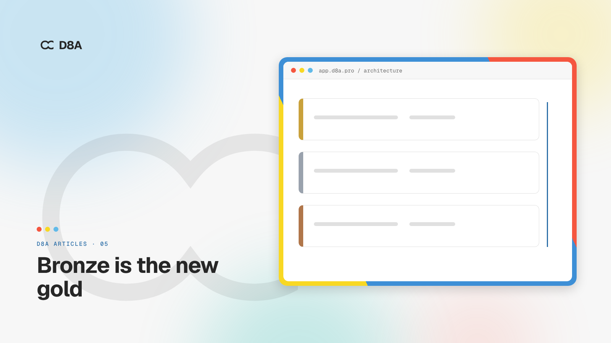
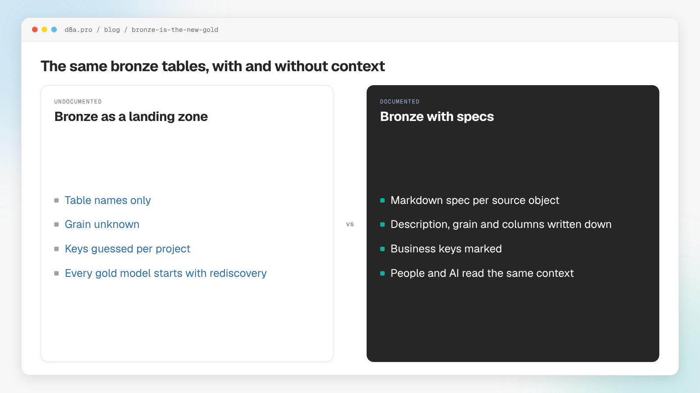
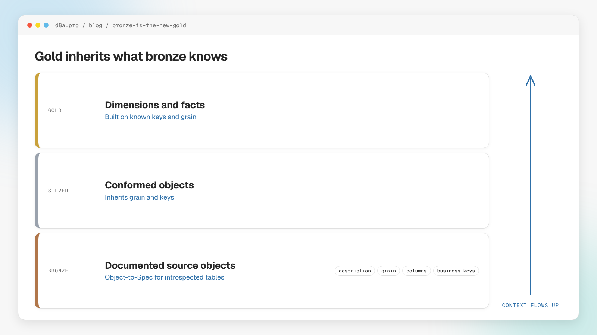
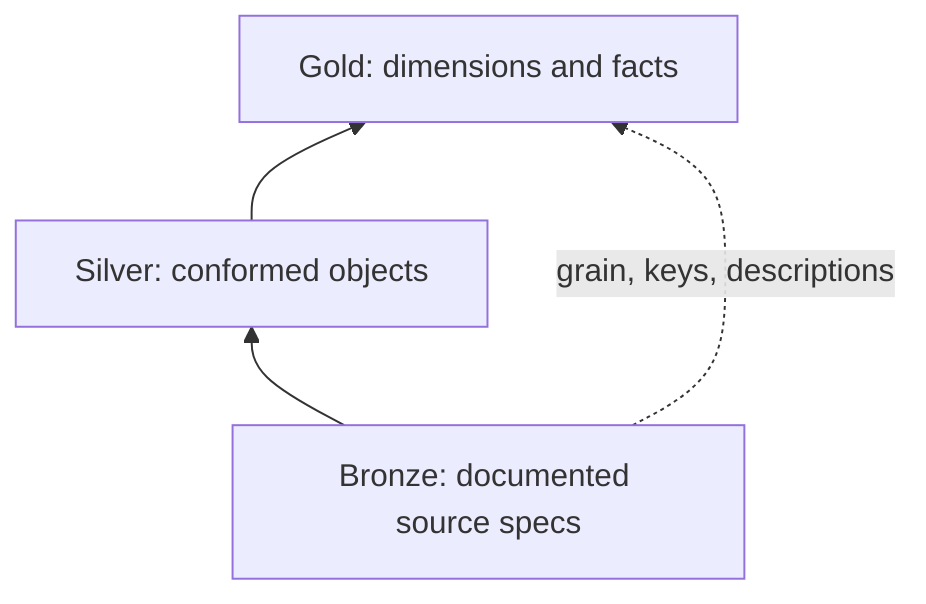

# Bronze is the new gold: the bronze layer in a medallion architecture

Most teams pour their effort into the gold layer and treat bronze as a landing zone nobody reads.
In a bronze layer medallion architecture, bronze is where the context lives, and gold can only be as good as the context it inherits.

> **TL;DR**
> - Gold tables built on undocumented bronze inherit guesswork: unclear grain, unknown keys, silent nulls.
> - D8A writes a Markdown specification for every bronze object, including source tables you introspect, so context exists from the first layer.
> - With documented bronze, AI generates silver and gold faster and with fewer wrong assumptions, and lineage starts at the source.

<!-- IMAGE PROMPT: Abstract hero for "Bronze is the new gold". Three stacked white bands with thick left borders in medallion colours: bronze #B0764A at the bottom, silver #9AA2AD in the middle, gold #C9A13B on top, with a thin body-blue arrow rising on the right to suggest context flowing up from bronze. D8A brand kit v5.0: canvas #F7F7F7, ink #262626, window chrome dots red/yellow/sky, one hard-stop color frame (red, sky-deep, yellow), soft ambient orbs, faint infinity watermark, Geist type, no people, no stock, no purple. 1600x900. -->

*Context starts at the bottom of the stack.*

## A quick recap of bronze, silver and gold

The medallion architecture splits a data platform into three layers. Bronze holds data as it arrives from source systems. Silver cleans, conforms and joins it. Gold models it for consumption: dimensions, facts and data products.

In May 2025 the Plainsight blog mapped out [the smart path to AI readiness](https://www.plainsight.pro/blog/the-smart-path-to-ai-readiness). Documenting bronze was one of its steps: "Bronze data (logs, raw feeds, etc.) contains valuable signals but only if it's documented and partially cleaned." That roadmap put bronze after gold, because documenting raw sources by hand is slow. With specs generated from the sources themselves, it no longer has to wait. This post shows what bronze looks like when it is documented by default.

## Why gold is only as good as bronze

Picture a Gold dimension for customers. To build it, an engineer has to know which source tables hold customer records, what one row means in each of them, which column is the business key, and how the source handles deletes.

If bronze is undocumented, that knowledge lives in someone's head or in an old Slack thread. Every new gold model starts with rediscovery. Two engineers make two different assumptions, and you end up with two customer counts that do not match.

The gold layer gets the attention because it is what dashboards read. The quality of that gold layer is decided two layers down.

## What a documented bronze layer looks like

In D8A, every Data Object has a specification: a Markdown file in your own Git repository. That includes bronze objects.

For tables that already exist in your source systems, D8A introspects the platform and runs Object-to-Spec. It generates documentation specs for the source objects, in batches per layer or pattern. On a connection's layer you can switch on "Auto generate & update documentation of source objects", so the documentation stays current when sources change. Layers that hold existing tables can be marked "Managed Externally", which keeps D8A from trying to own their code.

A bronze specification is written in plain language, so the business can read and correct it.

<!-- IMAGE PROMPT: Side-by-side comparison on a white card with window chrome. Left grey column titled "Undocumented bronze" with items: table names only, grain unknown, keys guessed per project, knowledge in people's heads, every gold model starts with rediscovery. Right ink column titled "Documented bronze" with items: Markdown spec per source object, description, grain and columns written down, business keys marked, AI and people read the same context. D8A brand kit v5.0, Geist, no purple. 1600x900. -->

*The same tables, with and without context.*

### What goes into a bronze spec

The sections come from the Spec Instructions on your Data Layer, so your team decides the template. A typical bronze spec covers:

- **Description:** what the source object is and which business process creates it.
- **Grain:** what one row means.
- **Columns:** name, type, data type, and which columns are business keys.
- **Notes:** known quirks, such as soft deletes or late-arriving records.

Because the template lives in the Blueprint, every bronze object in the workspace follows the same structure.

## How context flows up to silver and gold

When an engineer asks for a new Gold dimension, the AI Builder drafts a Spec-DAG: the chain of specs from bronze through silver to gold. It reads the bronze specs to understand the sources. With a clear grain and marked business keys, the drafted silver and gold specs start from facts instead of guesses.

Each gold spec then records its lineage with lines such as "Reads from" pointing at the upstream spec. D8A derives object-level Lineage and Column Lineage from specs and code. Because these links are AI-inferred, D8A presents them as inferences, so reviewers know what to check.

<!-- IMAGE PROMPT: Layered diagram on a white card with window chrome. Three stacked bands, top to bottom: "Gold" (border gold #C9A13B, sub "Dimensions and facts, built on known keys"), "Silver" (border silver #9AA2AD, sub "Conformed, inherits grain and keys"), "Bronze" (border bronze #B0764A, sub "Documented source objects", chips "description", "grain", "columns", "business keys"). A body-blue arrow on the right pointing up labelled "context flows up". D8A brand kit v5.0, Geist, no purple. 1600x900. -->

*Gold inherits what bronze knows.*

The Marketplace includes a Medallion Blueprint and a Medallion (Microsoft Fabric) Blueprint. The Fabric variant puts bronze in a Lakehouse and silver and gold in a Warehouse, connected by a feed with cross-platform reads. Either way, the bronze layer medallion architecture starts with specs.

## What a documented bronze gives you beyond gold

A documented bronze pays off in three places.

The first is speed. Engineers and AI stop rediscovering sources for every new use case. The grain, keys and meaning of a source are written down once, so the second, third and tenth gold model built on it start from that knowledge.

The second is a catalogue that is current. When every bronze object has a spec, your source catalogue exists as a side effect. We cover that in [D8A versus a data catalogue](./data-catalogue-alternative.md).

The third is safer change. When a source column changes, D8A's Impact List shows which downstream objects reference it, and Refresh Downstream helps repair them. That works because the chain is written down from the first layer.

It also makes domain teams faster. When a business unit starts its own workspace, a documented bronze gives them a reliable starting point. See [Data Mesh without the mess](./data-mesh-without-the-mess.md).

> [!NOTE]
> **Key takeaway:** In a bronze layer medallion architecture, documentation comes first. Write a spec for every bronze object, and silver and gold get faster to build and easier to trust.

## FAQ

### What is the bronze layer in a medallion architecture?
Bronze is the first layer, where data lands from source systems with little or no transformation. Silver cleans and conforms it, and gold models it for consumption.

### Why document the bronze layer if users only see gold?
Gold models depend on knowing the grain, keys and behaviour of the sources. If that knowledge is not written down in bronze, every gold model starts with rediscovery and risks wrong assumptions.

### Does D8A document existing source tables?
Yes. D8A introspects the platform and runs Object-to-Spec to generate Markdown documentation specs for source objects. You can set a layer to auto-generate and update that documentation when sources change.

### Do I need the Medallion Blueprint to use D8A?
No. Medallion is one of several Marketplace Blueprints, next to options such as Kimball star, Data Vault patterns and lakehouse. You can also build your own Data Architecture on the Blueprint canvas.

## Read next

- [Specs are the new code](./specs-are-the-new-code.md): why the specification becomes the source of truth.
- [D8A versus a data catalogue](./data-catalogue-alternative.md): how specs give you a catalogue that stays current.
- [Data Mesh without the mess](./data-mesh-without-the-mess.md): how domain teams build on a shared architecture.

---
**Stop managing process. Start shipping data.** See how D8A documents your bronze layer and builds gold on top of it.
**[Book a D8A demo](mailto:hello@d8a.pro?subject=D8A%20demo)** · [Join the waitlist](https://d8a.pro/#waitlist) · [Start with the overview: what is D8A?](./what-is-d8a.md)
