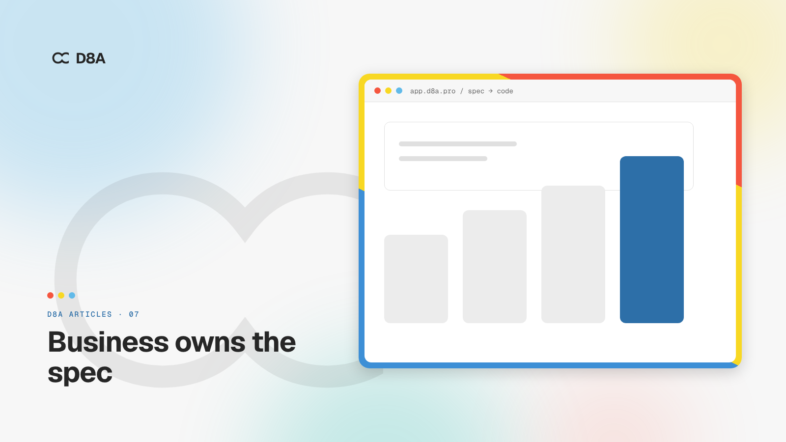
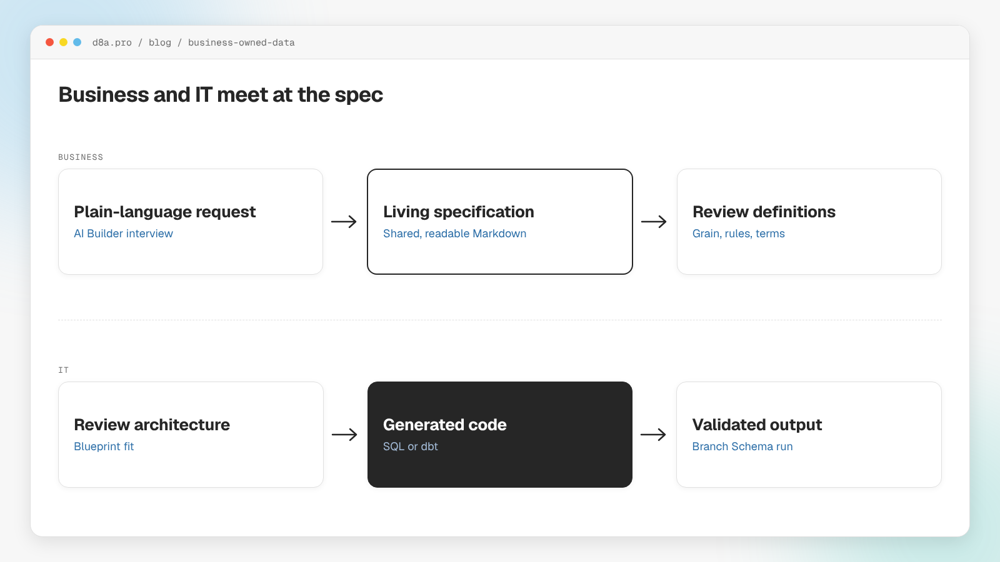
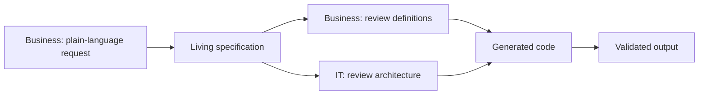
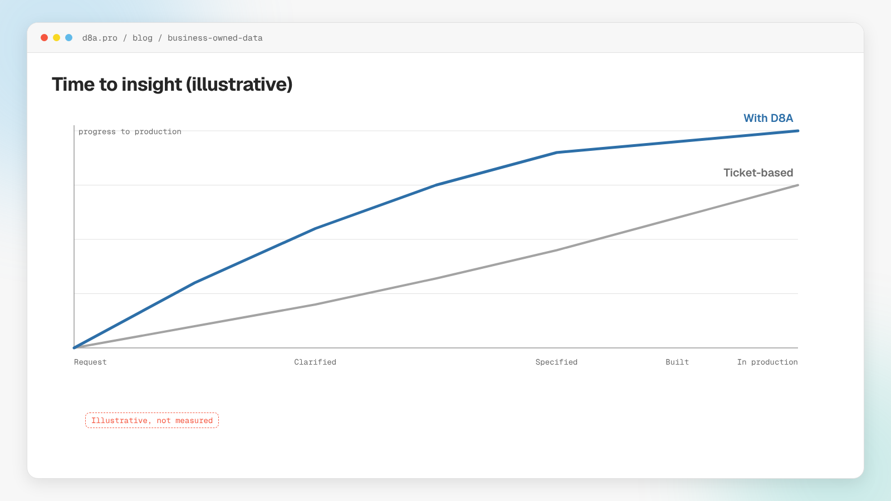

# Business ownership of data: what D8A changes for your business

Business people know what the numbers should mean, yet they hand that knowledge to IT through tickets and then wait.
Business ownership of data becomes real when the business owns the specifications, and in D8A that is where context and requirements live.

> **TL;DR**
> - In D8A, requests start in plain business language and become a reviewable specification the business can read.
> - Business people own the content (definitions, grain, rules), engineers own the architecture, and AI generates the code from both.
> - Less translation between business and IT means fewer rewrites and a shorter path from question to insight.

<!-- IMAGE PROMPT: Abstract hero for a blog about business ownership of data. A wide white card on top with two grey text lines (a business request), and below it four rising bars, the last one in body blue, suggesting insight arriving faster. D8A brand kit v5.0: canvas #F7F7F7, ink #262626, body blue #2D6FA8, chrome dots red/yellow/sky, one hard-stop color frame (red, yellow, sky-deep), soft ambient orbs, faint infinity watermark, Geist type, no people, no stock, no purple. 1600x900. -->

*Every person is a data person.*

## Why business ownership of data rarely works today

Most companies already have "data owners" on paper. In practice, the business owns a name in a governance document while IT owns everything that matters: the definitions in code, the transformation logic and the documentation.

The result is translation work. A sales manager asks for "active customers per region". An analyst writes a ticket. An engineer interprets "active" one way, builds it, and the sales manager sees a number that does not match their own spreadsheet. The D8A positioning calls this "vague requests, drifting code": business language never becomes a reviewable spec, so code drifts from what was asked.

## The business owns the spec, AI writes the code

D8A changes where the business meets the data. It meets it at the specification.

A specification in D8A is a Markdown file per Data Object, written in plain language: a description, the grain, the columns and the transformation logic. It sits in your own Git repository and is the source of truth from which code is generated and validated.

Because the spec is readable, the business can check it before any code exists. When the spec changes, the code is regenerated or flagged as out of date. Ownership of the content becomes ownership of the result.

## How a business request flows through D8A

1. **Request.** A business user opens a new request. The AI Builder interviews them about their business process.
2. **Spec.** The AI drafts a Spec-DAG: the specs for every object needed, from source to output.
3. **Review.** The business checks definitions and rules. An engineer checks the architecture. Confirm specs commits them to a feature branch with a linked Work Item.
4. **Code.** Spec-to-code generates SQL or dbt following your Blueprint, and Code Execution runs it in an isolated Branch Schema.
5. **Merge.** Review and merge, at the Automation Mode your team has set for that step.

<!-- IMAGE PROMPT: Two-row flow diagram on a white card with window chrome. Row label "Business": boxes "Plain-language request" then "Review definitions". Row label "IT": boxes "Review architecture" then "Generated code". In between, a highlighted box "Living specification" shared by both rows. Body-blue arrows. D8A brand kit v5.0, Geist, no purple. 1600x900. -->

*Business and IT meet at the spec.*

## Business context lives in the platform

Specs are not the only place where business knowledge lands. D8A keeps several layers of business context next to the technical work.

- **Strategy.** The Business Strategy Coach and Data Strategy Coach turn an interview into a strategy with weighted Strategy Pillars.
- **Use cases.** Every use case in the Use Case Register is scored against those pillars, plus impact, feasibility and size. The Use Case Assistant helps a business member write one.
- **Ontology.** Business Domains and Entities are bound to Data Objects, so "customer" in a conversation maps to specific tables.

This is what we mean by every person is a data person. The business needs a place where its own language is the starting point, without learning infrastructure. For how strategy flows into delivery, read [strategy grounded in your own data](./strategy-grounded-in-data.md).

## Faster time to insight

When fewer handoffs sit between a question and an answer, delivery gets faster. The waiting disappears first. The request becomes a spec in one conversation, the requester confirms what was meant before any code exists, and the documentation is finished when the code is merged.

The chart below shows the shape of that change.

<!-- IMAGE PROMPT: Line chart on a white card with window chrome. X axis: stages "Request", "Clarified", "Specified", "Built", "In production". Grey line "Ticket-based" rising slowly, body-blue line "With D8A" reaching production sooner. Small mono label "Illustrative, not measured". D8A chart rules, horizontal grid only, Geist labels, no 3D. 1600x900. -->

*Illustrative shape: fewer handoffs mean the request reaches production sooner.*

What we can say without numbers is where the time goes. The ticket ping-pong between business and IT shrinks because the spec answers the questions upfront. Rework drops because code is validated against the spec the business already approved.

## What changes for business owners

Business ownership comes with real work. Someone has to keep definitions current and review specs when processes change. We call that role the [context owner](./context-owner.md): the person who owns the specification, while engineers own the architecture and AI writes the code.

This does not have to start big. Pick one domain where definitions cause the most debate, such as revenue or active customers, and let the business owner review those specs first. The same workflow then extends to the next domain.

For IT, this frees up capacity. Engineers spend less time interviewing and translating and more time on architecture and review. We cover that side in [the impact of D8A on your team](./data-team-capacity.md).

> [!NOTE]
> **Key takeaway:** Business ownership of data works when the business owns something concrete. In D8A that is the specification: plain language, version-controlled and the source of the code.

## FAQ

### What does business ownership of data mean in D8A?
The business owns the content of specifications: definitions, grain, rules and terminology. Engineers own the Data Architecture, and AI generates code that follows both.

### Do business users need to write SQL?
No. They describe what they need in plain language, and the AI Builder drafts the specification. They review the spec, not the code.

### How does D8A keep business definitions consistent?
Specs follow a template from the Blueprint, and the Ontology binds business Domains and Entities to Data Objects. A term like "customer" maps to the same objects across specs.

### Can the business change a spec after delivery?
Yes. Specs live in your Git repository and change through branches and review like code. When a spec changes, D8A flags the related code as out of date and can regenerate it.

## Read next

- [Context owner: the new role in the autonomous data platform](./context-owner.md): who keeps the specs current.
- [Strategy grounded in your own data](./strategy-grounded-in-data.md): how strategy links to delivered use cases.
- [What is the impact of D8A on your team?](./data-team-capacity.md): what changes for your data engineers.

---
**Stop managing process. Start shipping data.** See how a plain-language request becomes a spec your business can own.
**[Book a D8A demo](mailto:hello@d8a.pro?subject=D8A%20demo)** · [Join the waitlist](https://d8a.pro/#waitlist) · [Start with the overview: what is D8A?](./what-is-d8a.md)
