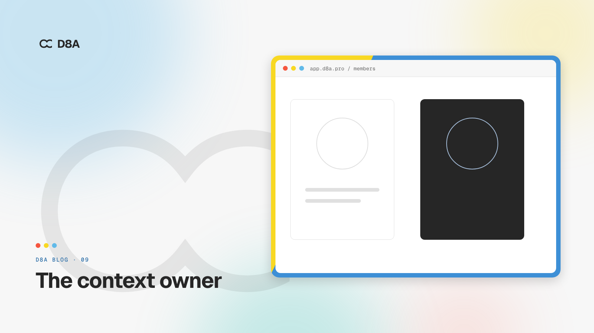
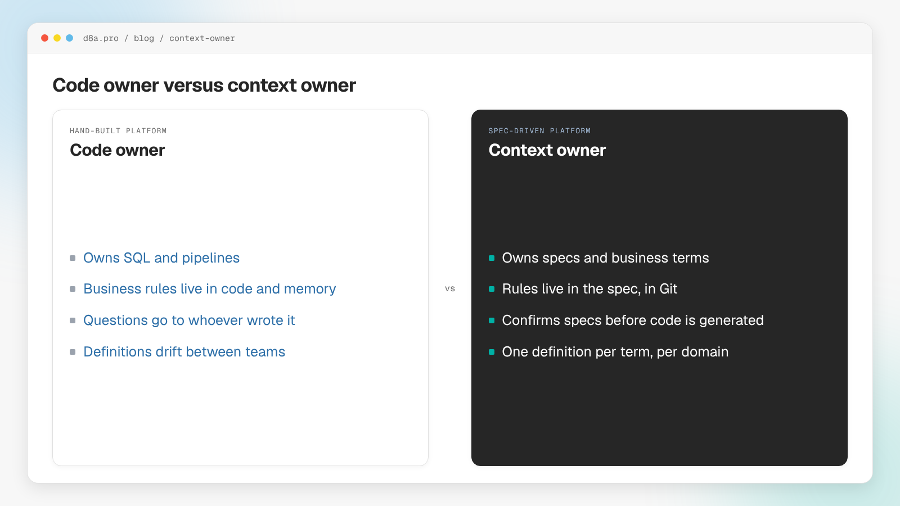
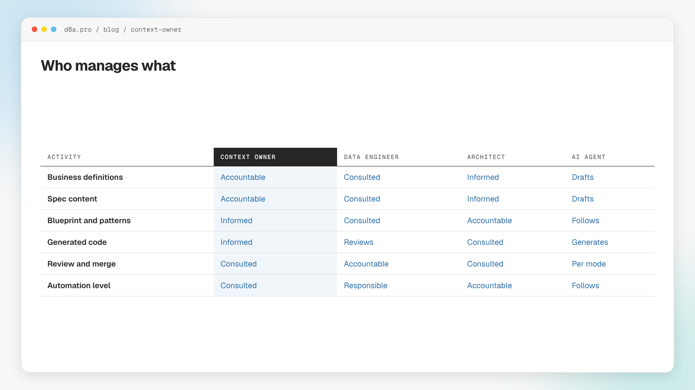

# Context owner: the new data role in the autonomous data platform

Who owns a table when nobody writes its code by hand any more?
The answer is the person who owns its meaning: the context owner data role.

> **TL;DR**
> - When code is generated from specifications, owning the code stops being the job that matters. Owning the spec does.
> - A context owner is responsible for the business context, terminology and rules in the specs of a domain. Engineers own the architecture and review the output.
> - The role merges parts of the data owner and data steward into one accountable person who works where the code is made.

<!-- IMAGE PROMPT: Abstract hero for a blog about a new data role. Light canvas #F7F7F7 with blurred orbs in sky, teal, yellow. Right side: white app window with chrome dots (red, yellow, sky), mono URL "app.d8a.pro / members", inside two tall cards: a white card with an empty circle avatar outline and a dark ink card with a dark-sub circle outline, suggesting two roles side by side. One hard-stop frame (yellow to sky-deep). Left: eyebrow "D8A blog · 09" and the words "The context owner" in Geist Bold ink. Faint infinity watermark. No people photos, no purple. -->

*The person who owns the meaning sits next to the people who own the platform.*

## Why code ownership stops being the point

In a hand-built data platform, ownership follows the code. The engineer who wrote the customer model knows its quirks, so questions go to them. Business rules end up in SQL comments, tickets and memory.

D8A changes the order. Every Data Object has a Specification, a Markdown file in your own Git repository with the description, grain, columns, transformation logic and lineage. Code is generated from it and checked against it. If you want different behaviour, you change the spec, and Spec-to-code regenerates the SQL or dbt model. We cover the mechanics in [specs are the new code](./specs-are-the-new-code.md).

Once code follows specs, the code owner role loses most of its weight. The question that matters becomes: who decides what the spec should say?

## What is a context owner?

A context owner is the person accountable for the business context of a domain: the definitions, terms, rules and priorities that end up in its specifications. They do not write SQL. They make sure "active customer", "net revenue" or "on-time delivery" mean the same thing in the spec as in the boardroom.

D8A is designed around this way of working. Business users describe what they need in plain language, the AI drafts a Spec-DAG, and someone with domain knowledge confirms the specs before code is generated. The context owner is that someone, for their domain. `[NEED: confirm Context Owner role in product; role grid not enforced yet per SecurityModel]`

Today, permissions in D8A are workspace based: organization roles plus a Workspace Admin flag. The context owner is an operating role you assign in your team, not a permission the product enforces per domain yet.

<!-- IMAGE PROMPT: Side-by-side comparison in D8A brand style on a white window card with chrome dots. Left white card titled "Code owner" (tag "Hand-built platform") with grey bullet points; right dark ink card titled "Context owner" (tag "Spec-driven platform") with teal bullet points. Mono "vs" between them. Geist type, body blue text on white, white text on ink. -->

*Code owners guard the implementation. Context owners guard the meaning.*

## Context owner vs data owner vs data steward

Most governance frameworks split the work in two. A data owner is accountable for a data domain, often a senior business manager. A data steward does the daily work: definitions, quality rules, catalogue entries.

The weak point is distance. Owners sign off on policies, stewards edit a glossary, and engineers build the pipelines somewhere else. Definitions drift because nobody's edits change the code.

The context owner closes that distance. Their edits land in the specification, and the specification is what the code is generated from. One person, accountable for meaning, working in the file that drives delivery. That also explains why a spec-driven setup can replace a separate [data catalogue project](./data-catalogue-alternative.md): the context is maintained where it is used.

## Who does what in a spec-driven team?

A clear split avoids two failure modes: business users designing architecture, and engineers guessing at business rules.

<!-- IMAGE PROMPT: RACI-style table in D8A brand style on a white window card with chrome dots. Columns: Activity, Context owner, Data engineer, Architect, AI agent. Rows: business definitions, specification content, Blueprint and patterns, generated code, review and merge, automation level. Header row mono uppercase, highlighted column for Context owner with dark ink header. Body blue cell text, hairline row dividers. -->

*A working split of responsibilities. Adapt it to your team.*

- **Context owner:** owns business definitions and the content of specs in their domain. Confirms new specs and approves changes in meaning.
- **Architect:** owns the Data Architecture in the Blueprint: layers, patterns, naming conventions and the Agentic Layer Instructions the AI follows.
- **Data engineer:** owns connections, reviews generated code, handles edge cases and performance, and fixes failed runs.
- **AI agent:** drafts specs, generates code, proposes reviews, at the Automation Mode you set per board column: agent, agent with human validation, or human.

Human in command. Always. The AI drafts, and people decide.

> [!NOTE]
> **Key takeaway:** when code is generated from specs, accountability moves to the spec. Give every domain one context owner who owns its meaning, and let engineers own the platform.

## How to introduce context owners in your organisation

Start small. Pick one domain with a clear business lead and a known pain, such as conflicting revenue figures.

1. **Name the person.** Choose someone who already answers the "what does this number mean" questions. They need time in their week for it.
2. **Bind terms to objects.** Use the Ontology in D8A to group Entities into Domains and bind them to Data Objects. The context owner checks that the terms match how the business talks.
3. **Route changes through specs.** New requests start as plain-language descriptions. The context owner confirms the drafted specs before Spec-to-code runs.
4. **Review meaning, not syntax.** Code review stays with engineers. The context owner reviews the spec diff: descriptions, rules, column meaning.

Expect the role to shift where business and IT meet. We describe that change in [the impact of D8A on your business](./business-owned-data.md).

## What changes for engineers?

Engineers stop being the only people who know what a table means. That sounds like a loss and works as relief. Fewer interruptions, fewer tickets that start with "can you explain this column", and more time on architecture and hard problems.

It removes process work, not engineers.

## FAQ

### What does a context owner do?

A context owner is accountable for the business context of a data domain: definitions, terms, rules and priorities. In a spec-driven platform they maintain that context in the specifications that code is generated from. They confirm new specs and approve changes in meaning.

### Is a context owner the same as a data owner?

They overlap. A data owner is usually accountable for a domain at policy level, while a steward maintains definitions. A context owner combines the accountability with hands-on ownership of the spec content, so definitions change in the same place the code comes from.

### Does a context owner need technical skills?

No SQL is required. They need deep knowledge of the business domain and the discipline to keep definitions precise. Engineers and the architect handle the platform, code review and architecture.

### Does D8A enforce context owner permissions?

Not yet. D8A has organization roles and a Workspace Admin flag today, and domain-level grants are not built. You assign the context owner as an operating role in your team. `[NEED: confirm Context Owner role in product; role grid not enforced yet per SecurityModel]`

## Read next

- [D8A versus a data catalogue](./data-catalogue-alternative.md): how living specs replace a separate catalogue project.
- [What is the impact of D8A on your business?](./business-owned-data.md): why the business should own specs and content.
- [Specs are the new code](./specs-are-the-new-code.md): the principle behind the role.

---
<!-- NEED: replace with demo booking URL when live -->
**Stop managing process. Start shipping data.** See how a context owner confirms a spec and D8A generates the code from it.
**[Book a D8A demo](https://d8a.pro/#waitlist)** · [Start with the overview: what is D8A?](./what-is-d8a.md)
