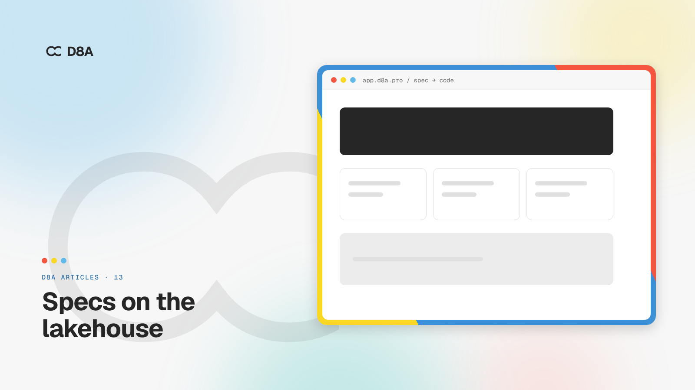
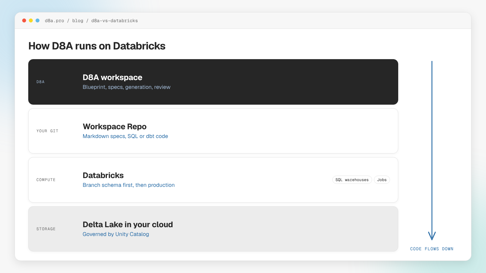
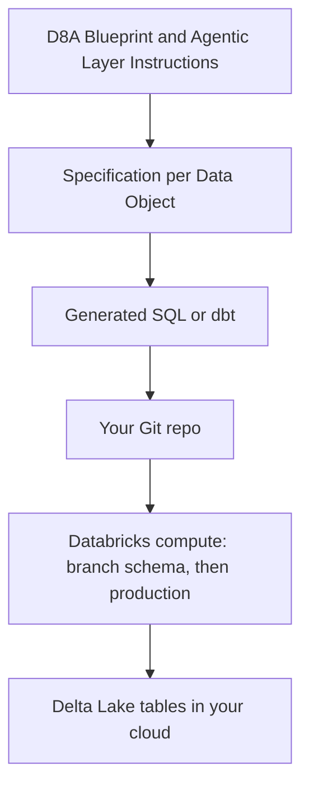
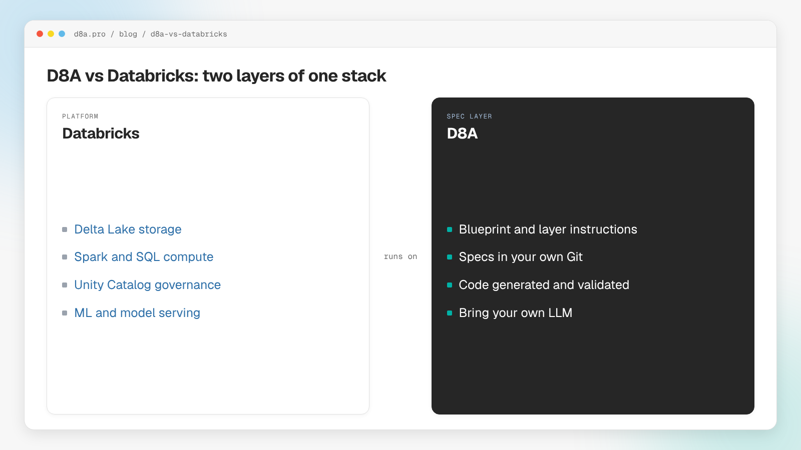

# D8A vs Databricks: specs on top of the lakehouse

Databricks gives your engineers one of the strongest lakehouse engines on the market.
D8A gives them a written, versioned answer to the question every lakehouse eventually raises: what should we build here, and how?

> **TL;DR**
> - Databricks is a data and AI platform built on the lakehouse: Delta Lake storage, Spark and SQL compute, Unity Catalog governance.
> - D8A is a spec-driven DataOps workspace that generates and validates the code your Databricks workspace runs.
> - In a D8A vs Databricks evaluation, the realistic outcome is both: Databricks for storage and compute, D8A for specs, standards and delivery.

<!-- IMAGE PROMPT: Abstract hero for a comparison article. Light canvas #F7F7F7, two stacked panels: an ink #262626 panel on top labelled only with faint placeholder lines (specs), three white cards below (engines), a tray panel at the bottom (storage). Infinity stroke watermark at 8% ink. One hard-stop color frame red, yellow, sky deep around a white app card with chrome dots. Soft blurred orbs sky, teal, yellow. D8A brand kit v5.0, Geist, no people, no stock, no purple. 1600x900. -->

*The lakehouse stores and computes. The spec layer decides what gets built.*

## What Databricks does well

Databricks describes itself as a data intelligence platform built on the lakehouse architecture ([Databricks docs: What is Databricks?](https://docs.databricks.com/aws/en/introduction/)). Data sits in open Delta Lake tables in your own cloud storage. Spark, SQL warehouses and serverless compute process it. Unity Catalog governs access, lineage and discovery across workspaces ([Unity Catalog docs](https://docs.databricks.com/aws/en/data-governance/unity-catalog/)).

For engineering-heavy teams, that combination is hard to beat. You get notebooks, jobs, ML tooling and model serving on one platform. Data stays in open formats in your cloud account.

Databricks also includes an AI assistant that helps users write and explain code in notebooks and SQL ([Databricks Assistant docs](https://docs.databricks.com/aws/en/notebooks/databricks-assistant-faq)). Like any assistant, it helps the person at the keyboard. It does not know your delivery process or which architecture rules a new table must follow unless someone tells it every time.

## Where D8A fits on Databricks

D8A works one level above the engine. It does not store data and it does not run Spark itself. It works on metadata: schemas, specifications, lineage and code.

Your architecture is declared once in a Blueprint. Data Layers (for example Bronze, Silver, Gold) and Data Patterns (Staging, Dimension, Fact) each carry Agentic Layer Instructions: how specs and code for that layer must be written. Every Data Object gets a Specification, a Markdown file in your own Git repository. D8A generates SQL or dbt code from it and validates the code against the spec on every save.

Code then runs on Databricks through a Connection, first in a per-branch schema so it can be reviewed before merge. The dbt adapter list includes Databricks, so teams that already work in dbt can keep that Code Format.

<!-- IMAGE PROMPT: Layered architecture schematic in D8A brand style. Top ink band "D8A workspace": Blueprint, Specifications, generation and review. Second white band "Your Git repo": Markdown specs, SQL or dbt code. Third white band "Databricks": SQL warehouses and jobs. Bottom tray band "Delta Lake in your cloud storage" with Unity Catalog chip. Blue arrow on the right labelled "code flows down". Chrome dots, Geist, canvas #F7F7F7, no purple. 1600x900. -->

*D8A writes and validates the code. Databricks runs it on your Delta tables.*

D8A can also use Databricks as the LLM. With a Databricks model serving LLM Connection, D8A's prompts are answered by models inside your own Databricks workspace.

## D8A vs Databricks: side by side

| | Databricks | D8A |
|---|---|---|
| Approach | Lakehouse platform: storage formats, compute, governance, ML | Spec-driven DataOps workspace: strategy, specs, code generation, review |
| Ownership of code and specs | Notebooks and jobs in the workspace; Git folders available ([docs](https://docs.databricks.com/aws/en/repos/)) | Specs and generated code live in your Git repo (GitHub or Azure DevOps) |
| Lock-in | Open Delta format; compute and platform features are Databricks | Specs are plain Markdown; the same specs can target another platform |
| LLM choice | Databricks Assistant and model serving | Your own LLM Connection, including Databricks model serving, Azure AI Foundry, Anthropic, Bedrock, Google AI, OpenRouter, Cortex |
| Documentation | Table and column comments, AI-generated comments in Unity Catalog ([docs](https://docs.databricks.com/aws/en/comments/ai-comments)) | Every object has a living spec; source documentation generated by introspection |
| Catalogue | Unity Catalog | Data Objects, Ontology and AI-inferred lineage derived from specs and code |
| Team impact | One platform for engineers, analysts, data scientists | Shared Blueprint and instructions, so every engineer builds the same way |
| Cost model | Consumption-based DBUs plus cloud infrastructure ([pricing](https://www.databricks.com/product/pricing)) | Subscription priced on spec capacity and AI credits; compute stays on Databricks |

<!-- IMAGE PROMPT: Side-by-side comparison graphic in D8A brand style. Left white card "Databricks" with grey bullets: Delta Lake storage, Spark and SQL compute, Unity Catalog, ML and model serving. Right ink card "D8A" with teal bullets: Blueprint and instructions, Specs in your Git, Generated and validated code, Bring your own LLM. Mono "runs on" between. Canvas #F7F7F7, Geist, chrome dots, no purple. 1600x900. -->

*Databricks owns the engine and the governance of data. D8A owns the specs and the delivery process.*

## When to choose which

Choose **Databricks on its own** when you need a lakehouse and a strong engineering team already has consistent standards and enough capacity.

Choose **D8A on Databricks** when the platform is fine but delivery is the bottleneck. Common signs: the same patterns are rebuilt per team, nobody can say which spec a notebook implements, and business requests take weeks to turn into a table. D8A turns plain-language requests into a reviewable Spec-DAG, then into code that follows your Blueprint.

Choose **D8A alongside more than one platform** when Databricks is one of several targets. A Data Architecture can contain multiple Data Platforms, and specs stay put when the target changes.

## Can they work together?

Yes. That is the design. Databricks stays your storage and compute layer, and remains the place where your data and Unity Catalog live. D8A connects to the workspace, introspects existing tables, generates specs for them with Code-to-Spec or object-to-spec, and generates new code from specs.

What changes for the team is where decisions are recorded. Today they sit in notebooks, pull request comments and people's heads. With D8A they sit in specifications in your repository, and the AI follows them.

Automation Mode stays in your hands per board column: agent, agent with human validation, or human. Human in command. Always.

> [!NOTE]
> **Key takeaway:** D8A vs Databricks compares two layers of the same stack. Databricks runs the lakehouse. D8A makes sure what runs there matches a reviewed specification.

## FAQ

### Is D8A a Databricks alternative?

No. D8A has no storage or compute engine. It generates and manages code that runs on Databricks or another supported platform.

### Can D8A use Databricks models as its LLM?

Yes. D8A supports Databricks model serving as an LLM Connection, so prompts can be answered by models inside your own Databricks workspace. You map them to D8A's Model Roles.

### Does D8A work with existing Databricks code?

D8A can introspect existing tables and generate specifications from them. For dbt projects, dbt Takeover links your existing models from the manifest so you keep your project.

### Does D8A replace Unity Catalog?

No. Unity Catalog governs your data on Databricks. D8A keeps specifications, an Ontology and AI-inferred lineage for the objects it manages, as part of the delivery workflow.

## Read next

- [D8A vs Microsoft Fabric](./d8a-vs-microsoft-fabric.md): the same pattern on Microsoft's SaaS analytics platform.
- [What D8A does to your technology stack](./data-stack-storage-compute.md): storage and compute as a cost decision.
- [A sovereign data stack](./sovereign-data-stack.md): keep control of specs, code and your LLM.

More comparisons: [D8A vs Snowflake](./d8a-vs-snowflake.md), [D8A vs Palantir Foundry](./d8a-vs-palantir.md), [D8A vs dbt](./d8a-vs-dbt.md).

---
**Stop managing process. Start shipping data.** Watch D8A turn a request into a spec and Databricks-ready code.
**[Book a D8A demo](mailto:hello@d8a.pro?subject=D8A%20demo)** · [Join the waitlist](https://d8a.pro/#waitlist) · [Start with the overview: what is D8A?](./what-is-d8a.md)
