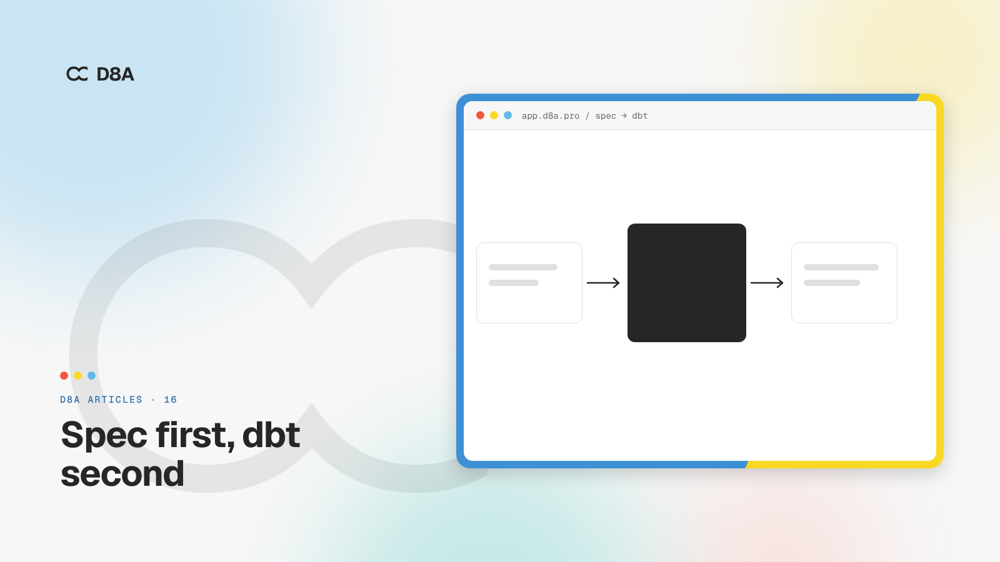
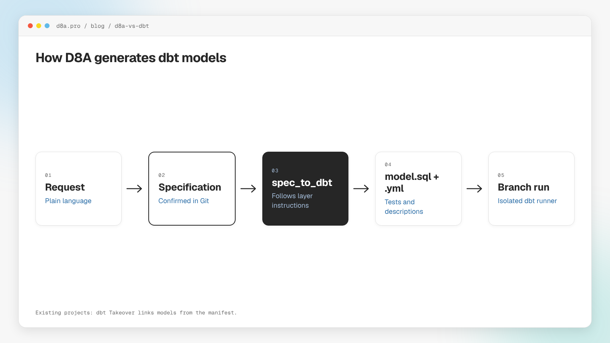
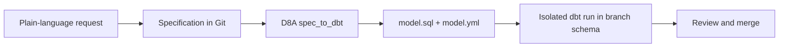
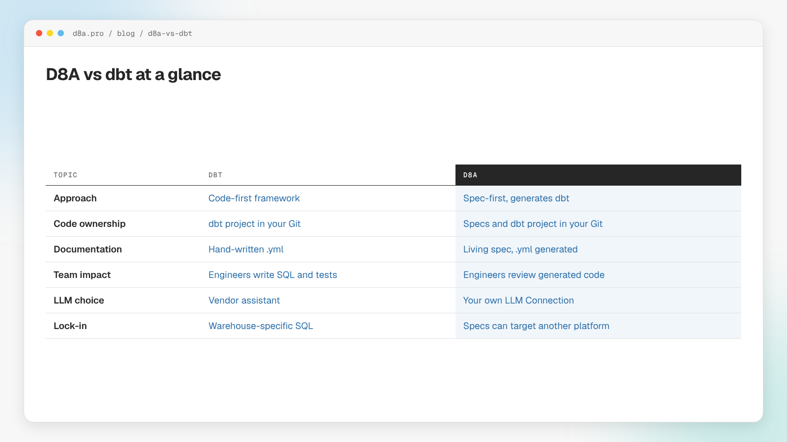

# D8A vs dbt: why you don't have to choose

dbt taught a generation of data teams to treat SQL like software: version control, tests, documentation.
D8A takes the next step. It writes the specification first, then generates the dbt model and its tests from it.

> **TL;DR**
> - dbt is a SQL transformation framework: models, tests, docs and lineage, compiled and run on your warehouse.
> - D8A is a spec-driven DataOps workspace. dbt is one of its two Code Formats, so D8A can generate dbt models and adopt existing dbt projects.
> - In the D8A vs dbt question, the answer for most teams is both: dbt as the build tool, D8A as the place where specs, standards and requests live.

<!-- IMAGE PROMPT: Abstract hero: light canvas #F7F7F7, a white app card in one hard-stop color frame (sky deep and yellow) with chrome dots. Inside: a compiler-style flow, white box, arrow, ink #262626 box, arrow, white box, with faint lines. Infinity stroke watermark 8% ink, blurred orbs sky, teal, yellow. D8A brand kit v5.0, Geist, no people, no stock, no purple. 1600x900. -->

*The spec comes first. The dbt model follows from it.*

## What dbt does well

dbt (data build tool) lets analysts and engineers write transformations as SQL SELECT statements, called models ([dbt docs: What is dbt?](https://docs.getdbt.com/docs/introduction)). dbt compiles them, works out the dependency order, and runs them on your warehouse. Tests, documentation and lineage come from the same project.

dbt Core is open source. dbt Cloud adds a hosted IDE, scheduling and other managed features ([dbt Cloud docs](https://docs.getdbt.com/docs/cloud/about-cloud/dbt-cloud-features)). A large community and package ecosystem sit around both.

dbt brought software practices to analytics work: Git, pull requests, tests in CI. Many teams in Belgium and the Netherlands run their transformation layer on it today.

## What dbt leaves open

dbt is a build tool. It runs what you write. It does not decide what should be written, check that a model matches what the business asked for, or make two engineers follow the same pattern for the same kind of table.

Those decisions still sit in tickets, wiki pages and code review comments. The `.yml` description of a model is often written after the fact, if at all. When a requirement changes, someone has to update the SQL, the tests and the docs by hand, in that order, and hope nothing drifts.

## How D8A uses dbt

D8A treats dbt as a first-class output. A Data Platform's Code Format is either plain SQL or dbt. With dbt selected, D8A's `spec_to_dbt` workflow generates two files per Data Object from its Specification: the model `.sql` and a `.yml` with tests and descriptions.

The flow looks like this:

1. A business user describes a need in plain language. D8A drafts a Spec-DAG of the objects involved.
2. **Confirm specs** commits the Specifications to a feature branch in your Git repo, linked to a Work Item.
3. D8A generates the dbt model and `.yml` from each spec, following the Agentic Layer Instructions and dbt Model Layout of that Data Layer.
4. The build runs in an isolated dbt runner, into a per-branch schema, and every Code Execution is recorded.
5. Review, then merge. The spec and the model stay linked, and a freshness badge flags drift.

<!-- IMAGE PROMPT: Flow schematic in D8A brand style, one row: "Request" → "Specification" (highlighted, hairline ink border) → "D8A generates" (ink #262626) → "dbt model + .yml" → "Branch schema run". Mono step tags 01 to 05, ink arrows, white cards. Caption-free. Chrome dots, Geist, canvas #F7F7F7, no purple. 1600x900. -->

*D8A writes the spec, generates the dbt files, and runs them in isolation before merge.*

Already have a dbt project? **dbt Takeover** reads your manifest and links existing models to D8A Data Objects. You keep your project. The customer owns the dbt project itself.

## D8A vs dbt: side by side

| | dbt | D8A |
|---|---|---|
| Approach | Code-first transformation framework | Spec-first workspace that generates code, including dbt |
| Ownership of code and specs | dbt project in your Git repo | Specs and generated dbt project in your Git repo |
| Lock-in | Open source core; SQL is warehouse-specific | Specs are plain Markdown; target platform can change |
| LLM choice | dbt Copilot in the dbt platform, with a dbt-managed or your own OpenAI or Azure OpenAI key ([docs](https://docs.getdbt.com/docs/dbt-ai/copilot-overview)) | Your own LLM Connection: Azure AI Foundry, Anthropic, Bedrock, Google AI, OpenRouter, Cortex, Databricks serving |
| Documentation | `.yml` descriptions and dbt docs site | Living spec per object; `.yml` descriptions generated from it |
| Catalogue | dbt docs and lineage graph | Data Objects, Ontology and AI-inferred lineage from specs and code |
| Team impact | Engineers write SQL and tests by hand | Engineers review generated code; business describes needs in plain language |
| Cost model | Core free; dbt Cloud per seat or plan ([pricing](https://www.getdbt.com/pricing)) | Subscription priced on spec capacity and AI credits; dbt Core runs in D8A's isolated runner |

<!-- IMAGE PROMPT: Comparison table graphic in D8A brand style: three columns "Topic", "dbt", "D8A" (D8A column header in ink #262626, column tinted light blue), rows Approach, Code ownership, Documentation, Team impact, LLM choice. Body text in body blue #2D6FA8, hairline row dividers #E0E0E0. Chrome dots, Geist, canvas #F7F7F7, no purple. 1600x900. -->

*dbt is the build tool. D8A decides what gets built and generates it.*

## When to choose which

Choose **dbt on its own** when your team writes models by hand, has clear conventions, and the bottleneck is not between business request and code.

Choose **D8A with dbt** when your dbt project keeps growing and consistency suffers. Typical signs: three styles of staging model, `.yml` files that lag behind the SQL, and requests that wait weeks for an engineer. D8A puts the conventions in the Blueprint and generates every new model from a spec.

Choose **D8A with plain SQL** when you do not use dbt and do not want to introduce it. D8A then generates idempotent SQL scripts per object instead.

## Can they work together?

Yes. This is the most direct "together" story in the versus series. dbt stays your build and test tool. D8A becomes the layer that holds the specs, applies your architecture, and writes the dbt code.

One limit to state clearly: D8A checks generated dbt code statically before the run. Your dbt tests then do what they always did when the model builds.

It removes process work, not engineers. Your engineers still review every model, at the Automation Mode you choose per board column.

> [!NOTE]
> **Key takeaway:** D8A vs dbt is a false choice. dbt runs and tests the models. D8A writes the specification first and generates the dbt model from it, so code and intent stay linked.

## FAQ

### Is D8A a dbt alternative?

No. D8A generates dbt code and can adopt existing dbt projects through dbt Takeover. If you do not use dbt, D8A can generate plain SQL instead.

### Can D8A take over our existing dbt project?

Yes. dbt Takeover reads your manifest and links existing models to D8A Data Objects. The dbt project stays yours, in your repository.

### Which warehouses does D8A support with dbt?

D8A's dbt adapter capability covers Postgres, SQL Server, Azure SQL, Synapse, Fabric, Snowflake, Databricks, BigQuery and Redshift.

### Does D8A write dbt tests?

D8A's `spec_to_dbt` workflow generates a `.yml` file with tests and descriptions next to each model, based on the specification.

## Read next

- [Specs are the new code](./specs-are-the-new-code.md): why the specification becomes your durable asset.
- [What D8A does to your technology stack](./data-stack-storage-compute.md): storage and compute bought on cost and speed.
- [A sovereign data stack](./sovereign-data-stack.md): keep specs, code and LLM choice in your hands.

More comparisons: [D8A vs Microsoft Fabric](./d8a-vs-microsoft-fabric.md), [D8A vs Databricks](./d8a-vs-databricks.md), [D8A vs Snowflake](./d8a-vs-snowflake.md), [D8A vs Palantir Foundry](./d8a-vs-palantir.md).

---
**Stop managing process. Start shipping data.** See D8A generate a dbt model and its tests from a spec.
**[Book a D8A demo](mailto:hello@d8a.pro?subject=D8A%20demo)** · [Join the waitlist](https://d8a.pro/#waitlist) · [Start with the overview: what is D8A?](./what-is-d8a.md)
