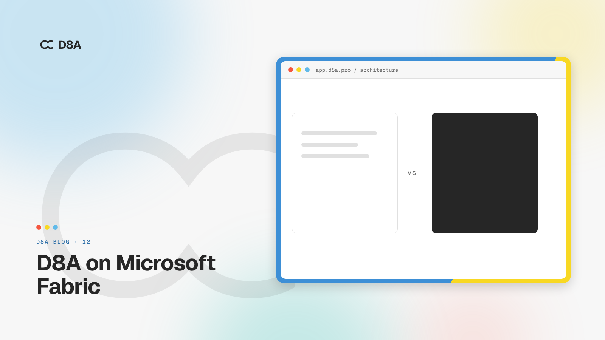
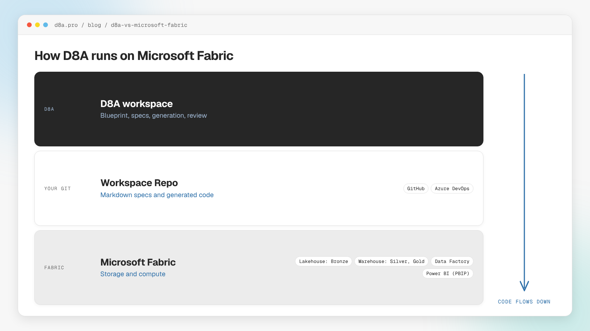
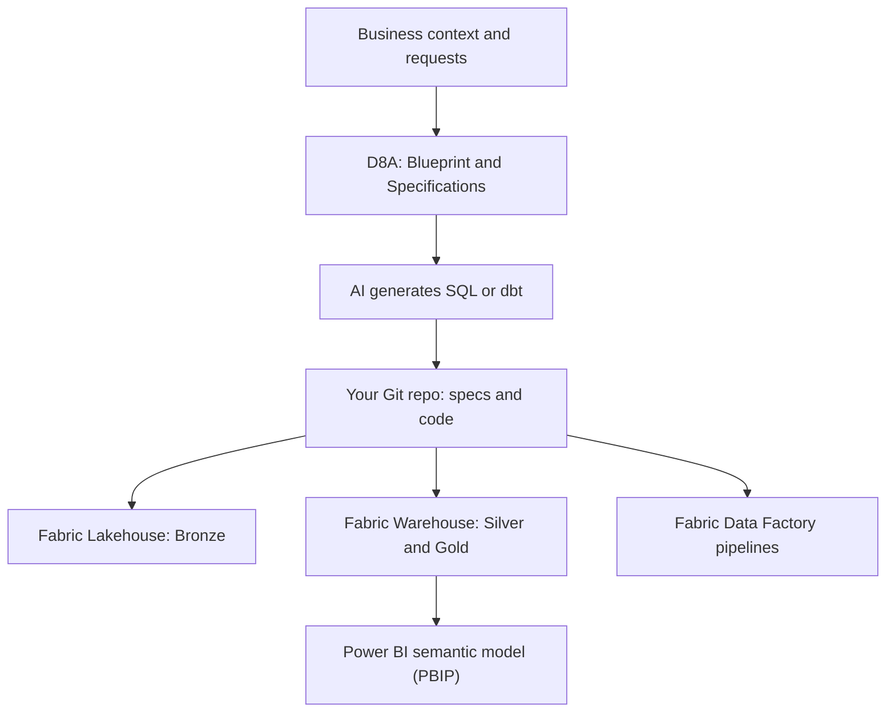
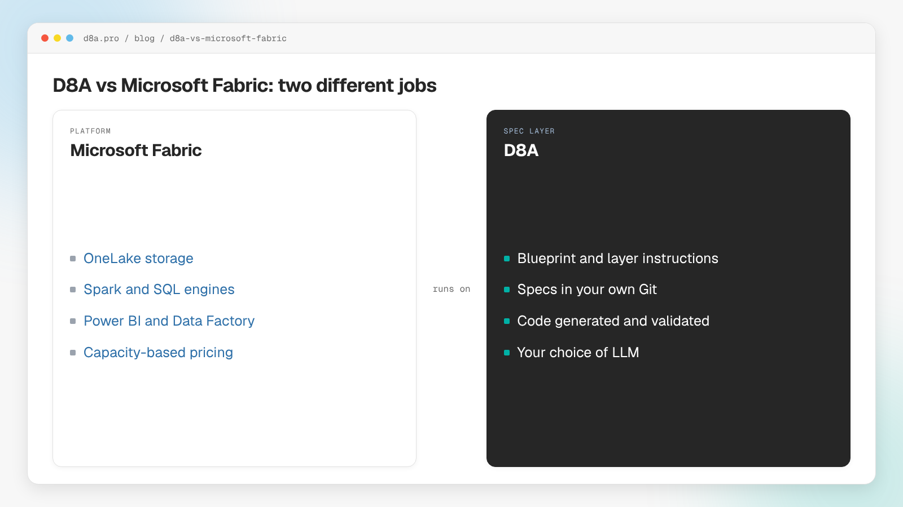

# D8A vs Microsoft Fabric: how they fit together

Comparing D8A and Microsoft Fabric is a bit like comparing an architect with a building site.
Fabric gives you the ground, the materials and the machines. D8A decides what gets built, and writes it down so it stays built the same way.

> **TL;DR**
> - Microsoft Fabric is a SaaS analytics platform: storage (OneLake), compute engines and Power BI in one place.
> - D8A is a spec-driven DataOps workspace: it turns business context into specifications, and specifications into code that runs on Fabric.
> - Most teams evaluating D8A vs Microsoft Fabric end up using both. Fabric runs the workloads, D8A owns the specs.

<!-- IMAGE PROMPT: Abstract hero for a comparison article. Two white panels side by side on a light canvas #F7F7F7: left panel outlined in hairline grey #E0E0E0 with faint placeholder lines, right panel in ink #262626. Small mono "vs" between them. Large infinity stroke watermark at 8% ink opacity behind. Window chrome dots red, yellow, sky on a white card inside one hard-stop color frame (sky deep and yellow). Soft blurred orbs in sky, teal, yellow. D8A brand kit v5.0, Geist type, no people, no stock photos, no purple. 1600x900. -->

*Two different jobs: Fabric runs the data, D8A defines what the data platform should be.*

## What Microsoft Fabric does well

Microsoft Fabric is Microsoft's end-to-end analytics platform, delivered as SaaS. It brings data integration, data engineering, data warehousing, real-time analytics and Power BI under one roof, on top of a single lake called OneLake ([Microsoft Learn: What is Microsoft Fabric](https://learn.microsoft.com/fabric/fundamentals/microsoft-fabric-overview)).

For a Microsoft-centred organisation that solves real problems. You buy capacity once and share it across workloads. Security and identity run through Microsoft Entra ID. Lakehouses, warehouses and semantic models sit in the same workspace your Power BI users already know.

Fabric also ships Copilot experiences that help individual users write code, queries and reports ([Microsoft Learn: Copilot in Fabric](https://learn.microsoft.com/fabric/fundamentals/copilot-fabric-overview)). That is useful. It is also a different job from the one D8A does.

## Where D8A sits next to Fabric

D8A is not another data platform. It does not store your data and it does not replace the Fabric engines. It works on metadata: schemas, lineage, specifications and code.

What D8A adds is the layer above the engines. Your architecture lives in a Blueprint: Data Platforms, Data Layers and Data Patterns, each with Agentic Layer Instructions that tell the AI how code for that layer must look. Every table gets a Specification, a Markdown file in your own Git repository. Code is generated from that spec and validated against it on every save.

The Marketplace contains a ready-made **Medallion (Microsoft Fabric)** Blueprint. It places Bronze in a Fabric Lakehouse and Silver and Gold in a Fabric Warehouse, joined by a feed with cross-platform reads. D8A can also generate Fabric Data Factory pipelines through an Orchestrator Connection, and Power BI semantic models as PBIP/TMDL.

<!-- IMAGE PROMPT: Architecture schematic in D8A brand style. Top band (ink #262626): "D8A workspace" with Blueprint, Specifications, AI generation. Middle band (white card): "Your Git repo" with specs and generated code. Bottom band (tray #ECECEC): "Microsoft Fabric" with Lakehouse (Bronze), Warehouse (Silver, Gold), Data Factory, Power BI. Arrow labelled "generated code runs here" pointing down. Window chrome dots, Geist type, canvas #F7F7F7, no purple. 1600x900. -->

*D8A generates the code; Fabric stores the data and runs the compute.*

## D8A vs Microsoft Fabric: side by side

The honest comparison is about responsibilities. Fabric answers "where does my data live and what runs it?" D8A answers "what should exist, why, and how must it be built?"

| | Microsoft Fabric | D8A |
|---|---|---|
| Approach | SaaS analytics platform: storage, engines, BI | Spec-driven DataOps workspace: strategy, specs, code generation, review |
| Ownership of code and specs | Code lives in Fabric items; Git integration available ([docs](https://learn.microsoft.com/fabric/cicd/git-integration/intro-to-git-integration)) | Specs and generated code live in your own Git repo (GitHub or Azure DevOps) |
| Lock-in | Data in open Delta format in OneLake; engines and capacity are Microsoft | Specs are plain Markdown; swap the target platform, keep the specs |
| LLM choice | Copilot in Fabric (Microsoft-managed) | Your own LLM Connection: Azure AI Foundry, Anthropic, Bedrock, Google AI, OpenRouter, Cortex, Databricks serving |
| Documentation | Item descriptions, Purview integration ([docs](https://learn.microsoft.com/fabric/governance/microsoft-purview-fabric)) | Every object has a living spec; source docs generated from introspection |
| Catalogue | OneLake catalog | Data Objects, Ontology and AI-inferred lineage derived from specs and code |
| Team impact | One platform for many personas | Same templates and instructions for every engineer; business describes needs in plain language |
| Cost model | Capacity units (F SKUs) ([pricing](https://azure.microsoft.com/pricing/details/microsoft-fabric/)) | Separate subscription `[NEED: D8A pricing model]`; compute stays on your Fabric capacity |

<!-- IMAGE PROMPT: Side-by-side comparison graphic, D8A brand style. Left white card titled "Microsoft Fabric" with grey bullets: OneLake storage, Spark and SQL engines, Power BI, Capacity-based. Right ink card titled "D8A" with teal bullets: Blueprint and instructions, Specs in your Git, Code generated and validated, Your choice of LLM. Small mono "runs on" between them. Canvas #F7F7F7, Geist, chrome dots, no purple. 1600x900. -->

*Fabric provides the engines. D8A provides the instructions those engines execute.*

## When to choose which

Choose **Fabric on its own** if your main gap is infrastructure: you need a lake, a warehouse and BI, your team writes code by hand today, and you are happy with that process.

Choose **D8A on Fabric** if your platform already runs, but delivery is slow. Typical signals: business requests bounce between people, architecture standards live in a wiki nobody reads, and every engineer builds pipelines slightly differently. D8A encodes the standard once in the Blueprint and applies it to every generated artefact.

Choose **D8A without Fabric** if you run a different stack. D8A connects to Databricks, Snowflake, SQL Server, PostgreSQL, BigQuery and others. Define once. Deliver anywhere.

## Can they work together?

Yes, and that is the intended set-up for Microsoft customers. Fabric stays your storage and compute layer. D8A introspects the Lakehouse and Warehouse through a Connection, generates code that follows your Fabric conventions, and runs it there through Code Execution, in a per-branch schema before merge.

Two points matter for an IT lead:

- **Your data stays in Fabric.** D8A reads schemas and metadata, not row-level data.
- **Your LLM can stay in Azure.** With an Azure AI Foundry LLM Connection, prompts go to a model in your own Azure resource.

If you leave D8A, your specs and generated code are still in your repository and your Fabric items keep running. Deleting a D8A Organization leaves your Git repositories and data platforms untouched.

> [!NOTE]
> **Key takeaway:** D8A vs Microsoft Fabric is not an either/or decision. Fabric is where the data lives and runs. D8A is where the specs live, and the specs decide what runs.

## FAQ

### Is D8A a Microsoft Fabric alternative?

No. D8A does not store data or provide compute engines. It generates and manages the code that runs on Fabric, or on another platform you choose.

### Does D8A replace Copilot in Fabric?

They solve different problems. Copilot helps an individual write code or queries inside Fabric. D8A manages the lifecycle from request to specification, generated code, review and merge, following your architecture.

### Which Fabric items can D8A generate?

D8A generates SQL or dbt code for Fabric Lakehouses and Warehouses, Fabric Data Factory pipelines through an Orchestrator Connection, and Power BI semantic models as PBIP/TMDL. The Medallion (Microsoft Fabric) Blueprint in the Marketplace gives you a starting architecture.

### Does my data leave our Microsoft tenant?

D8A works on metadata such as schemas, specs and code, not on row-level data. Code runs on your Fabric capacity, and you can route LLM calls to Azure AI Foundry in your own resource.

## Read next

- [D8A vs Databricks](./d8a-vs-databricks.md): the same pattern on a lakehouse built around Spark and Delta.
- [What D8A does to your technology stack](./data-stack-storage-compute.md): why storage and compute become a cost decision, not a feature decision.
- [Take back control: a sovereign data stack](./sovereign-data-stack.md): who owns your specs, code and LLM.

Also in the versus series: [D8A vs Snowflake](./d8a-vs-snowflake.md), [D8A vs Palantir Foundry](./d8a-vs-palantir.md), [D8A vs dbt](./d8a-vs-dbt.md).

---
<!-- NEED: replace with demo booking URL when live -->
**Stop managing process. Start shipping data.** See D8A generate Fabric-ready code from a spec in your own workspace.
**[Book a D8A demo](https://d8a.pro/#waitlist)** · [Start with the overview: what is D8A?](./what-is-d8a.md)
