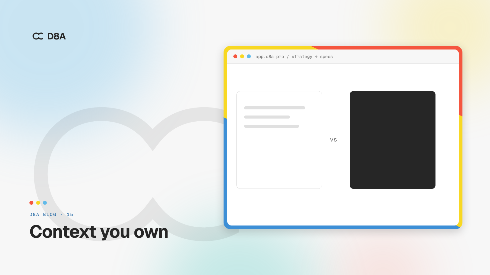
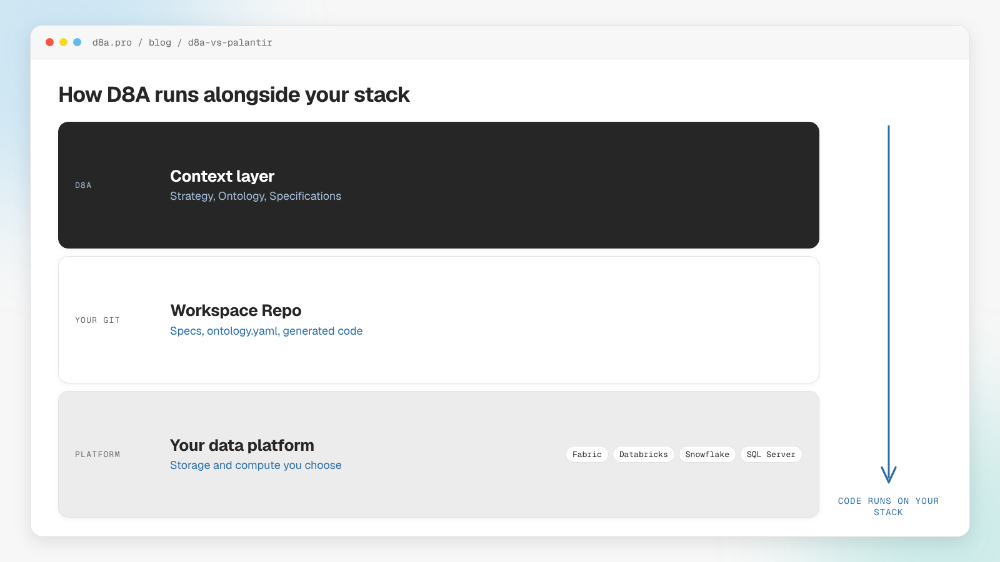
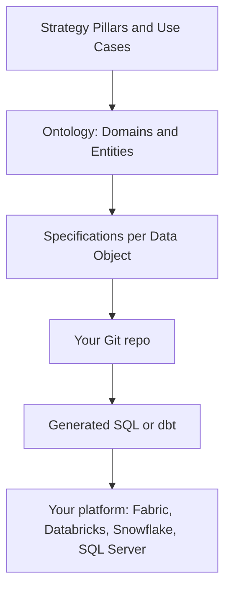
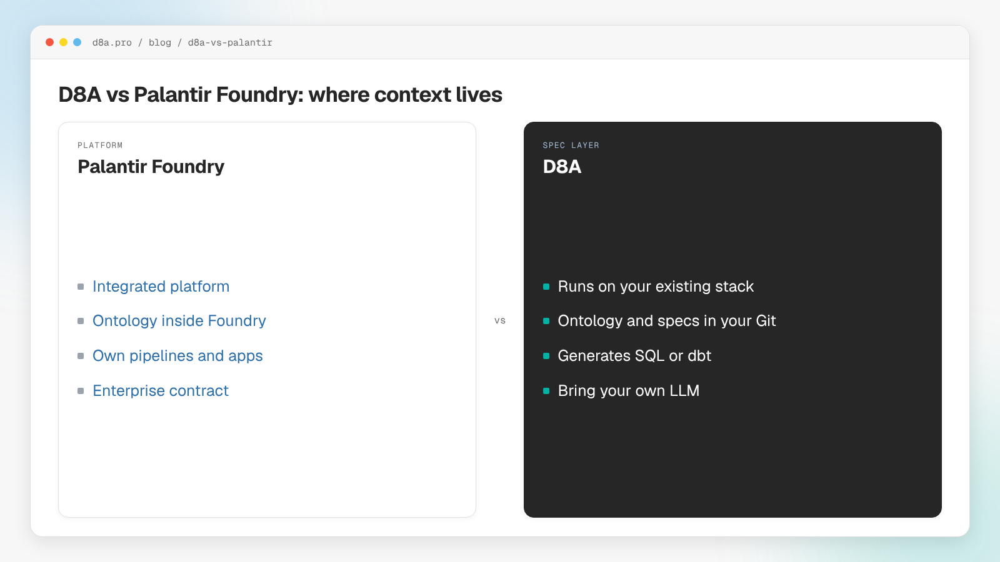

# D8A vs Palantir Foundry: two ways to put business context first

Palantir Foundry and D8A agree on one thing: data work should start from how the business sees the world.
They disagree on where that context should live, and on who owns the platform it runs on.

> **TL;DR**
> - Palantir Foundry is an integrated platform built around an Ontology that maps data to business objects, actions and applications.
> - D8A is a spec-driven DataOps workspace: business context lives in specifications and an Ontology in your own Git repo, and code runs on the platform you already have.
> - D8A vs Palantir Foundry is mostly a choice between buying one integrated platform and adding a context layer to your existing stack.

<!-- IMAGE PROMPT: Abstract hero: light canvas #F7F7F7, a white app card in one hard-stop color frame (red, yellow, sky deep) with chrome dots. Inside: two panels side by side, left white with hairline border, right ink #262626, mono "vs" between. Infinity stroke watermark at 8% ink, blurred orbs sky, teal, yellow. D8A brand kit v5.0, Geist, no people, no stock, no purple. 1600x900. -->

*Same starting point, business context. Different answers on ownership.*

## What Palantir Foundry does well

Foundry is Palantir's platform for data integration, analytics and operational applications ([Palantir Foundry](https://www.palantir.com/platforms/foundry/)). Its centre is the Ontology: a layer that represents data as business objects, their properties and links, and the actions people can take on them ([Palantir docs: Ontology overview](https://www.palantir.com/docs/foundry/ontology/overview/)).

That design lets business users work with "customers", "orders" or "aircraft" instead of tables. Foundry also brings its own pipeline tooling, application builders and AI features (AIP) in one environment ([Palantir AIP](https://www.palantir.com/platforms/aip/)).

For organisations that want a single vendor to deliver integration, modelling and operational apps, often with Palantir engineers on site, Foundry is a serious option. Pricing is not public `[NEED: source]`.

## Where D8A takes a different route

D8A also puts business context first. Its cascade starts with Strategy Pillars and a Use Case Register, moves through Specifications, and ends in generated code. It also has an Ontology: business Domains and Entities bound to Data Objects.

The difference is where all of that lives and what it runs on:

- **Context lives in your repository.** Specifications are Markdown files, the Ontology is a YAML file, the Data Architecture is a JSON file. All of it sits in your own Git repository on GitHub or Azure DevOps.
- **Compute stays on your stack.** D8A has no storage or compute engine. It generates SQL or dbt for platforms such as Fabric, Databricks, Snowflake, SQL Server, PostgreSQL or BigQuery, and runs it there.
- **You choose the LLM.** D8A calls the models you connect: Azure AI Foundry, Anthropic, Amazon Bedrock, Google AI, OpenRouter, Snowflake Cortex or Databricks model serving, with your own keys.

<!-- IMAGE PROMPT: Layered schematic in D8A brand style comparing ownership. Top ink band "D8A context layer": Strategy, Ontology, Specifications. Middle white band "Your Git repo": Markdown specs, ontology.yaml, generated code. Bottom tray band "Your platform": Fabric, Databricks, Snowflake, SQL Server chips. Blue arrow on the right "generated code runs on your stack". Chrome dots, Geist, canvas #F7F7F7, no purple. 1600x900. -->

*D8A adds the business context layer without replacing the platform underneath.*

## D8A vs Palantir Foundry: side by side

| | Palantir Foundry | D8A |
|---|---|---|
| Approach | Integrated platform: integration, Ontology, pipelines, applications, AI | Spec-driven DataOps workspace on top of your existing platform |
| Ownership of code and specs | Pipelines and Ontology defined inside Foundry `[NEED: source on export options]` | Specs, Ontology and generated code live in your Git repo |
| Lock-in | Business logic built in Foundry tooling `[NEED: source]` | Specs are plain Markdown; swap the target platform, keep the specs |
| LLM choice | AIP with supported models `[NEED: source]` | Your own LLM Connection across seven provider types, your own keys |
| Documentation | Ontology object and property descriptions | Every object has a living spec; source documentation generated by introspection |
| Catalogue | Data catalog and Ontology inside Foundry | Data Objects, Ontology and AI-inferred lineage derived from specs and code |
| Team impact | Often delivered with vendor engineers `[NEED: source]` | Your own team, working from one Blueprint and shared instructions |
| Cost model | Enterprise contract, not publicly listed `[NEED: source]` | Separate subscription `[NEED: D8A pricing model]`; compute on your platform |

<!-- IMAGE PROMPT: Side-by-side comparison graphic in D8A brand style. Left white card "Palantir Foundry" with grey bullets: Integrated platform, Ontology inside Foundry, Own pipelines and apps, Enterprise contract. Right ink card "D8A" with teal bullets: Runs on your stack, Ontology and specs in your Git, Generates SQL or dbt, Bring your own LLM. Mono "vs" between. Canvas #F7F7F7, Geist, chrome dots, no purple. 1600x900. -->

*Foundry bundles the platform. D8A leaves the platform choice with you.*

## When to choose which

Choose **Foundry** when you want one vendor for integration, modelling and operational applications, and you accept that the platform and much of the logic live inside it. It suits organisations that buy outcomes from a single provider.

Choose **D8A** when you already run a data platform, or want to choose one on cost and performance, and you want business context to stay in files you own. D8A suits data teams in Belgium and the Netherlands that run Microsoft, Databricks or Snowflake today and want faster delivery without a platform migration.

## Can they work together?

In principle, yes, though it is not the common pattern. Foundry can connect to external warehouses and lakes `[NEED: source]`. D8A can generate and maintain the curated layers in, for example, Snowflake or Databricks, which another tool can then read.

The more frequent conversation is a different one: a team that likes the Ontology idea but does not want to move its whole estate. D8A gives them business Entities and Domains bound to real Data Objects, specs that describe each object in business terms, and lineage from strategy to delivered use case, on the stack they already pay for.

> [!NOTE]
> **Key takeaway:** D8A vs Palantir Foundry is a question of ownership. Foundry keeps context and platform together in one product. D8A keeps context in your Git and lets the platform underneath stay yours.

## FAQ

### Is D8A a Palantir Foundry alternative?

For teams that want an Ontology-style business layer on their existing platform, it can be. D8A does not offer Foundry's operational application builders, and it does not store data.

### Does D8A have an ontology like Palantir?

D8A has an Ontology of business Domains and Entities bound to Data Objects by name, stored as a YAML file in your repository. It is used to ground specs and lineage. It is a different design from Foundry's Ontology with actions and applications.

### Where does D8A run my pipelines?

On your own data platform. D8A generates SQL or dbt and runs it through a Connection to platforms such as Fabric, Databricks, Snowflake, SQL Server or PostgreSQL.

## Read next

- [A sovereign data stack](./sovereign-data-stack.md): why owning specs, code and the LLM choice matters.
- [What D8A does to your technology stack](./data-stack-storage-compute.md): storage and compute bought on cost, not features.
- [D8A vs Snowflake](./d8a-vs-snowflake.md): how D8A works on a warehouse you already run.

More comparisons: [D8A vs Microsoft Fabric](./d8a-vs-microsoft-fabric.md), [D8A vs Databricks](./d8a-vs-databricks.md), [D8A vs dbt](./d8a-vs-dbt.md).

---
<!-- NEED: replace with demo booking URL when live -->
**Stop managing process. Start shipping data.** See how D8A adds business context to the platform you already run.
**[Book a D8A demo](https://d8a.pro/#waitlist)** · [Start with the overview: what is D8A?](./what-is-d8a.md)
