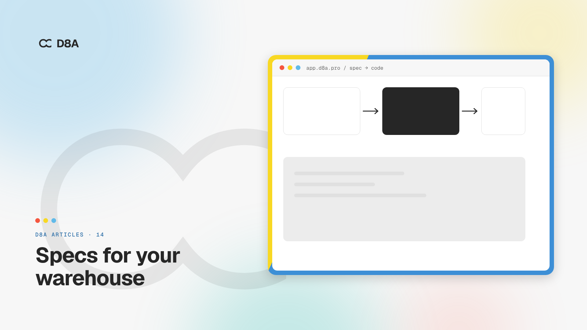
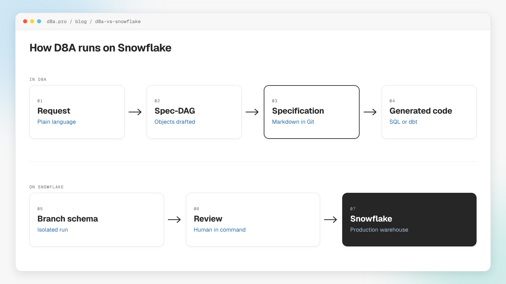
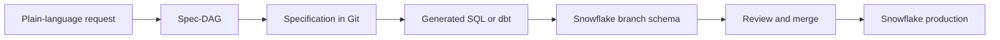
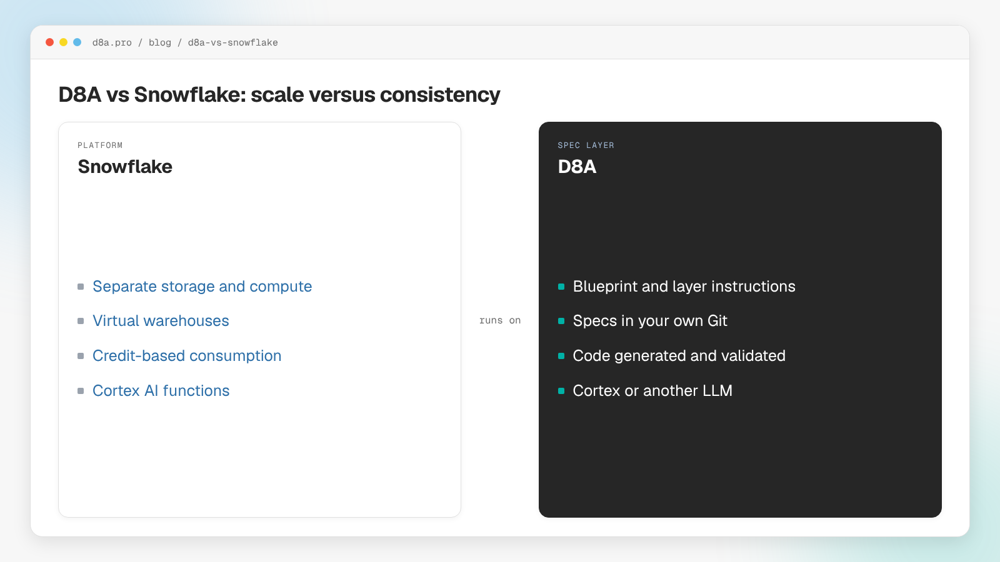

# D8A vs Snowflake: who decides what runs in your warehouse

Snowflake made it easy to store everything and scale compute on demand.
It did not make it easier to agree on what each table means, who asked for it, and how it must be built. That part is where D8A comes in.

> **TL;DR**
> - Snowflake is a cloud data platform with separate storage and compute, billed on consumption.
> - D8A is a spec-driven DataOps workspace that generates warehouse code from specifications kept in your own Git repository.
> - The D8A vs Snowflake question has a simple answer: Snowflake runs the warehouse, D8A writes and validates what runs in it.

<!-- IMAGE PROMPT: Abstract hero: light canvas #F7F7F7, a white app card inside one hard-stop color frame (sky deep and yellow) with chrome dots red, yellow, sky. Inside: a compact flow of three boxes, the middle one ink #262626, arrows in ink, plus a tray panel below with faint lines. Infinity stroke watermark 8% ink, blurred orbs sky, teal, yellow. D8A brand kit v5.0, Geist, no people, no stock, no purple. 1600x900. -->

*Specs go in at the top. Warehouse code comes out at the bottom.*

## What Snowflake does well

Snowflake is a cloud data platform that separates storage from compute ([Snowflake docs: key concepts and architecture](https://docs.snowflake.com/en/user-guide/intro-key-concepts)). Virtual warehouses scale independently, so a heavy transformation job does not slow down a dashboard. You pay for compute in credits and for storage per terabyte ([Snowflake pricing](https://www.snowflake.com/en/pricing-options/)).

It runs on AWS, Azure and Google Cloud, and needs very little infrastructure work from your team. Governance features such as access policies and tagging are part of the platform.

Snowflake Cortex adds LLM functions and AI services that run inside Snowflake ([Snowflake Cortex docs](https://docs.snowflake.com/en/guides-overview-ai-features)). That matters for D8A too, as you will see below.

## Where D8A fits on Snowflake

D8A does not store data and has no compute engine. It works on metadata: schemas, specifications, lineage and code. Its job is to decide what should exist in your warehouse and to produce the code that builds it.

The work starts with a Blueprint, your Data Architecture. It declares Data Platforms, Data Layers and Data Patterns, and carries the Agentic Layer Instructions the AI must follow per layer. Each Data Object gets a Specification in Markdown, stored in your Git repository.

From a spec, D8A generates plain SQL or dbt (Snowflake is in the dbt adapter list). The code is validated against the spec on save, executed through a Snowflake Connection in a per-branch schema, and reviewed before merge.

<!-- IMAGE PROMPT: Flow schematic in D8A brand style, two rows. Row 1: "Request" → "Spec-DAG" → "Specification" (highlighted) → "Generated SQL or dbt". Row 2: "Branch schema" → "Review" → "Snowflake" (ink, production warehouse). Ink arrows, white cards with hairline borders, mono tags. Chrome dots, Geist, canvas #F7F7F7, no purple. 1600x900. -->

*Every object Snowflake runs has a reviewed spec behind it.*

## Snowflake Cortex as D8A's LLM

D8A lets you choose which model writes your specs and code. One of the supported LLM Connections is Snowflake Cortex. With it, D8A's prompts are answered by models inside your own Snowflake account.

For teams that already have security approval for Cortex, that shortens the conversation with your CISO. You map Cortex models to D8A's Model Roles (general purpose, classifier, embedding), and the AI Workflows use them.

## D8A vs Snowflake: side by side

| | Snowflake | D8A |
|---|---|---|
| Approach | Cloud data platform: storage, elastic compute, governance | Spec-driven DataOps workspace: strategy, specs, code generation, review |
| Ownership of code and specs | SQL objects in the account; Git integration available ([docs](https://docs.snowflake.com/en/developer-guide/git/git-overview)) | Specs and generated code live in your Git repo (GitHub or Azure DevOps) |
| Lock-in | Proprietary storage by default; Iceberg tables supported ([docs](https://docs.snowflake.com/en/user-guide/tables-iceberg)) | Specs are plain Markdown; the same specs can target another platform |
| LLM choice | Cortex models | Your own LLM Connection: Cortex, Azure AI Foundry, Anthropic, Bedrock, Google AI, OpenRouter, Databricks serving |
| Documentation | Object comments and tags | Every object has a living spec; source documentation generated by introspection |
| Catalogue | Snowflake Horizon catalog ([docs](https://docs.snowflake.com/en/user-guide/snowflake-horizon)) | Data Objects, Ontology and AI-inferred lineage derived from specs and code |
| Team impact | Little infrastructure work for the team | One Blueprint, one set of instructions, the same build pattern for everyone |
| Cost model | Credits for compute, storage per TB | Subscription priced on spec capacity and AI credits ([D8A pricing](https://d8a.pro/pricing.html)); compute stays on Snowflake |

<!-- IMAGE PROMPT: Side-by-side comparison graphic in D8A brand style. Left white card "Snowflake" with grey bullets: Separate storage and compute, Virtual warehouses, Credit-based, Cortex AI. Right ink card "D8A" with teal bullets: Blueprint and instructions, Specs in your Git, Generated and validated code, Cortex or another LLM. Mono "runs on" between. Canvas #F7F7F7, Geist, chrome dots, no purple. 1600x900. -->

*Snowflake scales the compute. D8A keeps the build consistent.*

## When to choose which

Choose **Snowflake on its own** when you need a warehouse and your team has the capacity and the standards to hand-build every model.

Choose **D8A on Snowflake** when delivery is the bottleneck: requests wait in a queue, models drift from what the business asked, and new engineers need months to learn the house style. D8A writes the house style into the Blueprint and applies it to every generated object.

Choose **D8A across platforms** when Snowflake is one target among several. Define once. Deliver anywhere.

## Can they work together?

Yes. Snowflake stays the storage and compute layer, and your data never moves into D8A. D8A introspects the account through a Connection, generates specs for existing tables, and generates new code from specs.

There is also a cost angle. When every model is generated from the same patterns, you can tune those patterns once (incremental loads, clustering choices, warehouse sizing hints in the instructions) and every new object inherits them.

If you stop using D8A, the specs and code stay in your repository and your Snowflake objects keep running.

> [!NOTE]
> **Key takeaway:** in D8A vs Snowflake, Snowflake answers "where and how fast does this run?" and D8A answers "what should run, and is it built the way we agreed?"

## FAQ

### Is D8A a Snowflake alternative?

No. D8A has no storage or compute. It generates and manages the code that runs in Snowflake or on another supported platform.

### Can D8A use Snowflake Cortex?

Yes. Snowflake Cortex is a supported LLM Connection, so D8A's prompts are answered by models inside your own Snowflake account.

### Does D8A support dbt on Snowflake?

Yes. dbt is one of D8A's two Code Formats, and Snowflake is a supported dbt adapter. Existing dbt projects can be adopted with dbt Takeover.

### Does D8A read our warehouse data?

D8A works on metadata: schemas, specifications, lineage and code. It does not work on your row-level data.

## Read next

- [D8A vs Databricks](./d8a-vs-databricks.md): the same split of roles on a lakehouse.
- [What D8A does to your technology stack](./data-stack-storage-compute.md): buy storage and compute on cost and speed.
- [A sovereign data stack](./sovereign-data-stack.md): own your specs, your code and your choice of LLM.

More comparisons: [D8A vs Microsoft Fabric](./d8a-vs-microsoft-fabric.md), [D8A vs Palantir Foundry](./d8a-vs-palantir.md), [D8A vs dbt](./d8a-vs-dbt.md).

---
**Stop managing process. Start shipping data.** See a spec become Snowflake code in a live D8A workspace.
**[Book a D8A demo](mailto:hello@d8a.pro?subject=D8A%20demo)** · [Join the waitlist](https://d8a.pro/#waitlist) · [Start with the overview: what is D8A?](./what-is-d8a.md)
