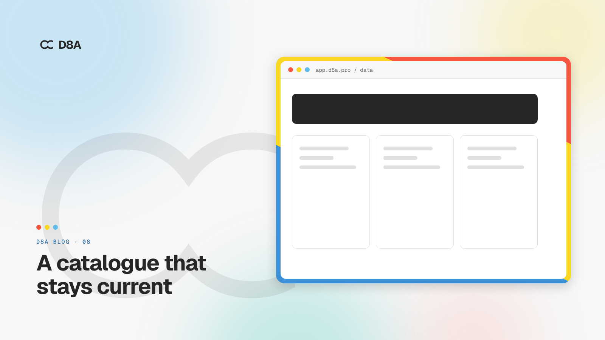
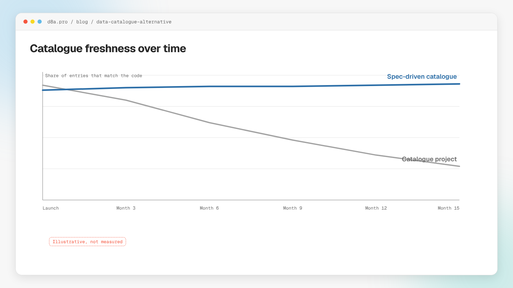
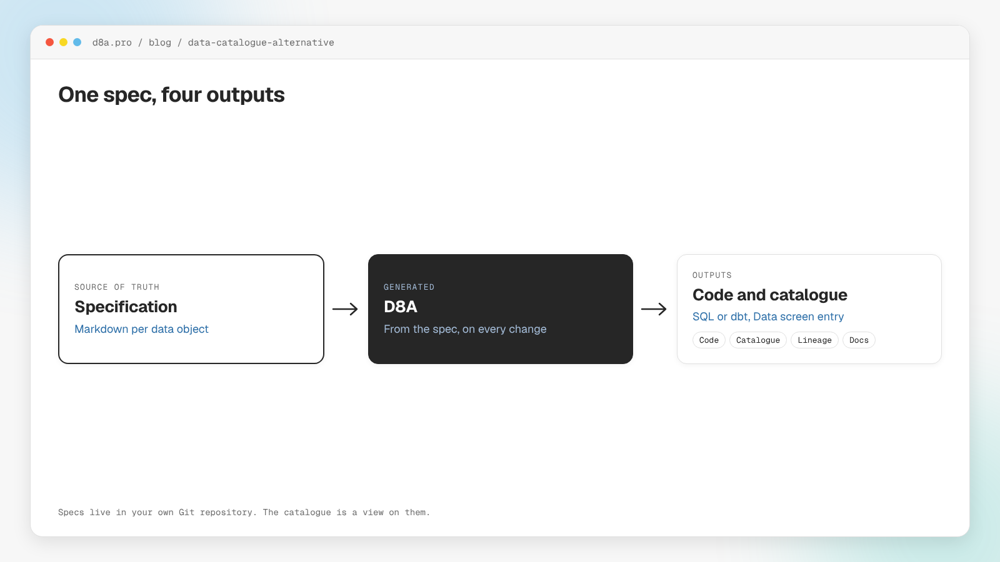
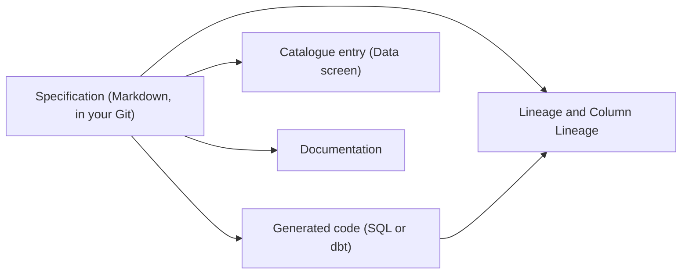

# D8A versus a data catalogue: the data catalogue alternative that stays current

No more data catalogue projects that are outdated before you actually start.
If your catalogue is written after the code, it will always trail the code. A spec-driven data catalogue alternative flips the order.

> **TL;DR**
> - Classic catalogue projects document tables after they exist, so descriptions start to rot on day one.
> - In D8A every Data Object has a living Specification in your Git repo, and code is generated from it. The catalogue is a view on those specs.
> - Lineage, column descriptions and change impact come from the same source, so they move with every commit.

<!-- IMAGE PROMPT: Abstract hero for a blog about replacing data catalogue projects. Light canvas #F7F7F7 with soft blurred ambient orbs in sky, teal and yellow. Right side: a white app window with three chrome dots (red, yellow, sky) and mono URL "app.d8a.pro / data", inside a dark ink header bar above three white catalogue cards with grey placeholder lines. One hard-stop color frame (red, yellow, sky-deep) around the window. Left: small eyebrow "D8A blog · 08" and the words "A catalogue that stays current" in Geist Bold ink. Large faint infinity stroke watermark. No people, no stock photography, no purple. -->

*The catalogue as a view on your specs.*

## Why do data catalogue projects go stale?

Most catalogue projects follow the same arc. A team buys a tool, connects it to the warehouse, and harvests table and column names. Then the hard part starts: someone has to write what each table means, who uses it and where it comes from.

That work runs beside delivery, on a separate track. Engineers ship a new model on Tuesday. The description gets updated in the catalogue on Friday, if it gets updated at all. After a few sprints the gap between what the catalogue says and what the code does is wide enough that people stop trusting it.

The catalogue then becomes a project of its own, with a backlog, a steward and a quarterly clean-up. You pay twice: once to build the data, and once to describe it.

<!-- IMAGE PROMPT: Line chart in D8A brand style on a white card with chrome dots and mono URL bar. Two lines over 15 months: grey line "Catalogue project" starting high and decaying steadily; body blue #2D6FA8 line "Spec-driven catalogue" staying high and flat. Horizontal grid lines #E0E0E0, mono tick labels M0 to M15, red dashed tag "Illustrative, not measured" top right. Geist labels, no legend box, direct labels. -->

*Illustrative shape, not measured data: documentation written after the code drifts; documentation the code is generated from does not.*

The pattern is familiar to most Heads of Data. The exact decay rate differs per team `[NEED: data or survey on catalogue freshness over time, if we want a number]`, but the cause is structural. Documentation that lives outside the delivery flow loses the race against delivery.

## What a spec-driven data catalogue alternative looks like

D8A starts from a different source of truth. Every Data Object (a table or model) has a Specification: a Markdown file in your own Workspace Repo, the Git repository you host on GitHub or Azure DevOps. The spec holds the description, the grain, the columns with their types, the transformation logic and the objects it reads from.

Code is generated from that spec. When someone changes the logic, they change the spec, and Spec-to-code regenerates the SQL or dbt model. A freshness check flags it when spec and code drift apart. So the description and the behaviour live in one file, reviewed in one pull request. We explain the idea in depth in [why specs are the new code](./specs-are-the-new-code.md).

In that setup, a catalogue stops being something you build. The Data screen in D8A lists every Data Object with its spec. You browse the catalogue that your delivery work already produced.

<!-- IMAGE PROMPT: Flow diagram in D8A brand style on a white window card with chrome dots. Left: a white highlighted node "Specification" (sub "Markdown per data object"). Arrow to a dark ink node "D8A" (sub "Generated from the spec"). Then three white output nodes stacked as one row: "Code", "Catalogue", "Lineage", "Docs". Geist type, body blue sub-labels, mono tags. No purple. -->

*One spec feeds the code, the catalogue entry, the lineage and the docs.*

## What you get without running a catalogue project

### Descriptions written at the moment of change

Business users describe a need in plain language. D8A drafts the specs as a Spec-DAG, and the team confirms them. The description is part of the request, so it exists before the first line of code does.

### Documentation for the tables you already have

Existing source tables are the hardest part of any catalogue. D8A can introspect them and draft documentation specs in batches per layer or pattern (Object-to-spec). There is also a connection setting to keep source documentation generated and updated. This is where [a documented bronze layer](./bronze-is-the-new-gold.md) starts.

### Lineage that follows the code

Lineage and Column Lineage are derived by the AI from the specs and the code. D8A presents each relationship as an inference, so reviewers know what they are looking at. When a column changes, the Impact List shows the downstream objects that read it, and Refresh Downstream helps you repair them.

### Business terms tied to real objects

The Ontology groups business Entities into Domains and binds them to Data Objects. A finance user searching for "customer" lands on the objects that implement it.

> [!NOTE]
> **Key takeaway:** a catalogue goes stale when it is a copy. Make the spec the source, and the catalogue becomes a view that is as current as your last merge.

## Who keeps the meaning right?

Tooling solves freshness. It does not solve meaning. Someone still has to decide what "active customer" means and approve the wording in the spec.

In a classic setup that person is a data steward who edits catalogue pages. In a spec-driven setup the same knowledge goes straight into the specification, the file the code is generated from. That is the job of a [context owner](./context-owner.md): the person who owns the business context and terminology of a domain, while the code follows. `[NEED: confirm Context Owner role in product; role grid not enforced yet per SecurityModel]`

The shift matters for budget too. You stop funding a separate documentation workstream. The time goes into better specs, which pay off in better code, better docs and a catalogue people can trust.

## When do you still need a dedicated catalogue tool?

Be honest about the edges. D8A catalogues the Data Objects it manages through specs in a Workspace. If you need an enterprise-wide inventory across many systems D8A does not touch, a dedicated catalogue may still have a role as the index on top. `[NEED: confirm integrations with catalogue tools such as Purview, Unity Catalog or Collibra; none found in the product today]`

D8A also works on metadata: schemas, lineage, specifications and code. It does not profile row-level data. If data quality profiling on actual values is a core requirement, plan for that separately.

For the data you build and change every week, the order is what counts. Spec first, then code, and the catalogue follows on its own.

## FAQ

### Is D8A a data catalogue tool?

D8A is an AI-powered DataOps workspace. It gives you catalogue functions (object list, descriptions, lineage, business terms) because every Data Object has a living specification. The catalogue is a by-product of how you deliver.

### How does D8A keep documentation up to date?

Code is generated from the specification, and D8A flags drift between spec and code. A change to logic starts as a change to the spec, so the documentation changes in the same pull request. For existing source tables, D8A can generate and update documentation specs from the introspected schema.

### Is lineage in D8A automatic?

D8A derives Lineage and Column Lineage from your specs and generated code with AI. Each relationship is shown as an inference, and lineage is stored per branch. The Impact List uses it to show what breaks downstream when a column changes.

### Can I start with an existing warehouse that has no documentation?

Yes. D8A introspects your data platform and can draft documentation specs for existing tables in batches per layer or pattern. Your team reviews and corrects them, and from then on the specs drive changes.

## Read next

- [Specs are the new code](./specs-are-the-new-code.md): why the specification, not the SQL, is the asset you should manage.
- [Context owner: the new role in the autonomous data platform](./context-owner.md): who owns the meaning once the catalogue writes itself.
- [Bronze is the new gold](./bronze-is-the-new-gold.md): why documentation should start at the bronze layer.

---
<!-- NEED: replace with demo booking URL when live -->
**Stop managing process. Start shipping data.** See how a living spec turns into code, lineage and a catalogue entry in one commit.
**[Book a D8A demo](https://d8a.pro/#waitlist)** · [Start with the overview: what is D8A?](./what-is-d8a.md)
