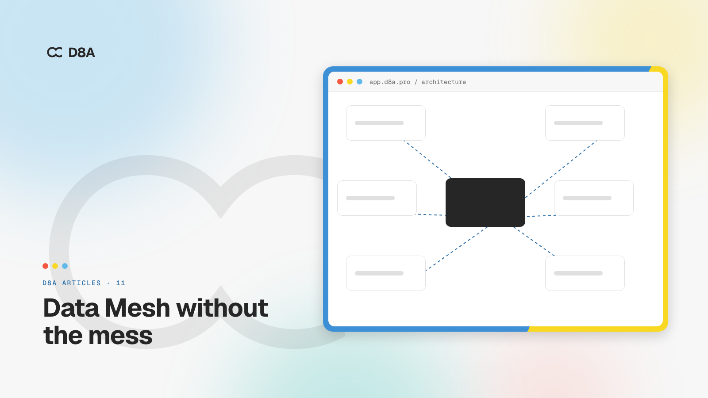
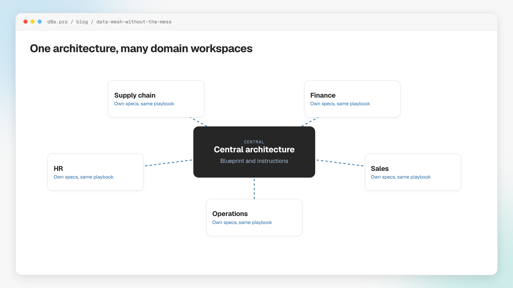
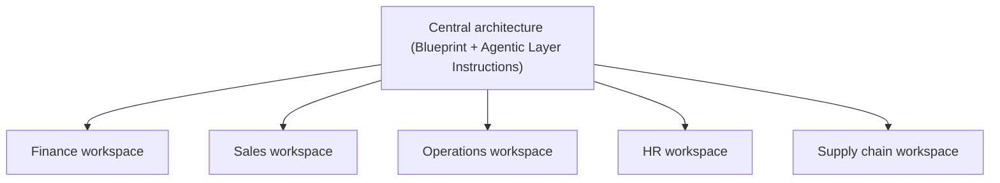
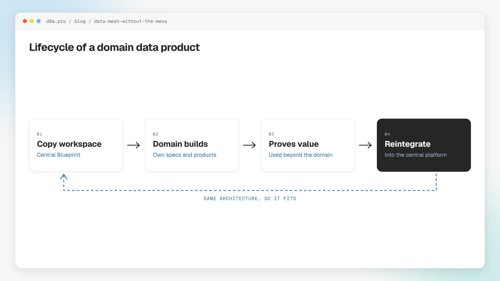
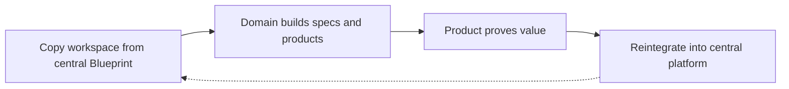

# Data Mesh without the mess: a practical data mesh implementation

Data Mesh promised autonomy for domains. Many teams got five platforms, five naming conventions and no way back.
A workable data mesh implementation gives domains freedom to build while the architecture stays shared.

> **TL;DR**
> - Data Mesh fails when every domain reinvents patterns, naming and quality rules.
> - In D8A the central team defines the architecture once in a Blueprint, with the instructions the AI follows, and hands domains their own workspace built on it.
> - Domains build their own specs and data products. Generated code follows the central playbook, so successful products are easier to bring back into the core platform.

<!-- IMAGE PROMPT: Abstract hero for a blog about data mesh. Light canvas #F7F7F7 with blurred orbs in sky, teal and yellow. Right side: white app window with chrome dots (red, yellow, sky), mono URL "app.d8a.pro / architecture", inside a dark ink central node connected with dashed body blue lines to six white domain nodes around it. One hard-stop frame (sky-deep to yellow). Left: eyebrow "D8A blog · 11" and the words "Data Mesh without the mess" in Geist Bold ink. Faint infinity watermark. No people, no purple. -->

*One architecture at the centre, domain teams building around it.*

## Why data mesh implementations get messy

The idea behind Data Mesh is sound. Domains know their data best, so they should own and publish it as products. A central team provides a self-serve platform and federated governance.

In practice, the platform part lags. Domains get a cloud subscription and a guideline document. Each team picks its own layering, naming and testing approach. Two years in, the central team cannot read half the pipelines, and integrating a domain product into the enterprise model means rebuilding it.

The guideline document is the weak point. Architecture standards in a wiki are advice. Nobody's code is generated from them, so nothing forces them to hold.

## A data mesh implementation built on one Blueprint

D8A turns the architecture into instructions. The central team defines the Data Architecture on the Blueprint canvas: Data Platforms, Data Layers, Data Patterns, naming conventions and path templates. Each layer and pattern carries Agentic Layer Instructions that tell the AI how specs are written and how code is generated.

You can start from a curated Blueprint in the Marketplace, such as Medallion, Kimball star, Lakehouse or dbt-oriented, or build your own. Patterns such as Data Vault hubs, links and satellites are available too. Every change to the architecture records an Architecture Version.

Then you distribute it. With Workspace Copy, you create a new Workspace for a business unit from an existing one, including its architecture, ontology and configuration. The domain gets its own workspace, connections and Git repository, on the same playbook.

<!-- IMAGE PROMPT: Hub-and-spoke diagram in D8A brand style on a white window card with chrome dots. Centre dark ink node "Central architecture" (sub "Blueprint and instructions"). Five white spoke nodes connected with dashed body blue lines: "Finance workspace", "Sales workspace", "Operations workspace", "HR workspace", "Supply chain workspace", each with sub "Own specs, same playbook". Geist type, mono tags. No purple. -->

*The central team owns the playbook. Domains own their specs and products.*

## What domains get

Inside their workspace, domain teams work like any D8A team. A business user describes a need in plain language. D8A drafts the specs as a Spec-DAG, grounded in the domain's data. The team confirms them, and Spec-to-code generates SQL or dbt that follows the central patterns.

That gives domains real autonomy where it counts: which products to build, in what order, with which definitions. Their own [context owners](./context-owner.md) keep the business meaning right. They do not have to decide again how a dimension is modelled or how a staging table is named.

It also lowers the bar to start. A domain without a senior data engineer can still produce well-structured objects, because the structure comes from the Blueprint and the AI follows it.

## What the centre keeps

The central team keeps control of the things that make data reusable across domains:

- the layer structure and modelling patterns,
- naming conventions and path templates,
- the instructions the AI follows for specs and code,
- the Marketplace Blueprints you choose to offer.

Data contracts between domains and the central platform are a common part of Data Mesh designs. In D8A, that agreement is written down in two places: the shared architecture every domain builds on, and the specification of each object, with its columns, types, grain and lineage. Both live in Git, so a change to either goes through review.

Domains run on whatever storage and compute they need, as long as D8A supports it. Specs and architecture stay put when the target changes, which keeps the [stack choice about storage and compute](./data-stack-storage-compute.md) instead of features.

> [!NOTE]
> **Key takeaway:** Data Mesh holds when the shared architecture is enforced by the way code is generated. Encode the playbook once, give each domain a workspace on it, and let them own the products.

## The lifecycle of a domain data product

A domain product often starts small: one team, one question, a handful of objects. If it proves its value, other domains want it, and it may belong in the central platform.

Because the domain built on the same Blueprint, its specs follow the same layers, patterns and naming as the core. Moving it is a matter of moving specs and code that already fit. The specs and code are files in the domain's Git repository, so the central team reviews them like any other change before taking them over.

<!-- IMAGE PROMPT: Lifecycle diagram in D8A brand style on a white window card with chrome dots. Four nodes in a row with arrows: "Copy workspace" (sub "Central Blueprint"), "Domain builds" (sub "Own specs and products"), "Product proves value" (sub "Used beyond the domain"), "Reintegrate" (dark ink, sub "Into the central platform"). A dashed body blue return arrow under the row labelled "Same architecture, so it fits". Geist type. -->

*Shared patterns are what make the way back possible.*

## Start from documented sources

A mesh is only as good as the data each domain starts from. If source tables are undocumented, every domain rediscovers them on its own. D8A can introspect existing tables and draft documentation specs per layer, so each workspace starts with a [well-documented bronze layer](./bronze-is-the-new-gold.md).

## FAQ

### What is a data mesh implementation?

It is the practical setup that lets business domains own and publish their data as products, on a shared self-serve platform with federated governance. The hard part is keeping architecture consistent across domains. D8A handles that by encoding the architecture as instructions that all generated code follows.

### How does D8A support Data Mesh?

The central team defines a Data Architecture in a Blueprint, with Agentic Layer Instructions for each layer and pattern. Workspace Copy creates domain workspaces from it, each with its own repo and connections. Domains create their own specs and products, and the code follows the central playbook.

### Do domains need their own data engineers?

They need people who know the domain and can confirm specs. Engineering patterns come from the shared Blueprint, so a domain without senior engineers can still produce consistent objects. Central engineers review where needed.

### Does D8A support data contracts?

The shared architecture and the per-object specifications (columns, types, grain, lineage) act as the agreement between domains and the centre today. Because both live in Git, every change to them is reviewed and traceable.

## Read next

- [Context owner: the new role in the autonomous data platform](./context-owner.md): who owns meaning inside each domain.
- [Bronze is the new gold](./bronze-is-the-new-gold.md): why every domain should start from documented sources.
- [What is the impact of D8A on your technological stack?](./data-stack-storage-compute.md): storage and compute as the only job your platform needs to do.

---
**Stop managing process. Start shipping data.** See how one Blueprint becomes a workspace for every domain.
**[Book a D8A demo](mailto:hello@d8a.pro?subject=D8A%20demo)** · [Join the waitlist](https://d8a.pro/#waitlist) · [Start with the overview: what is D8A?](./what-is-d8a.md)
