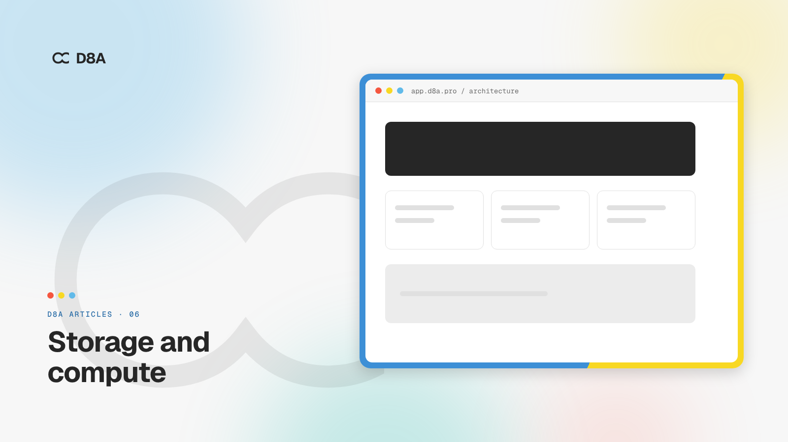
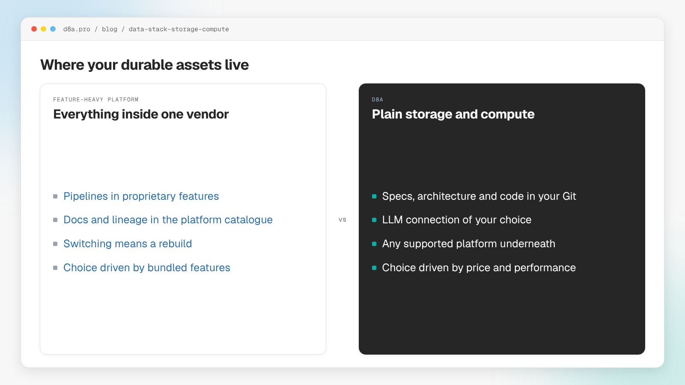
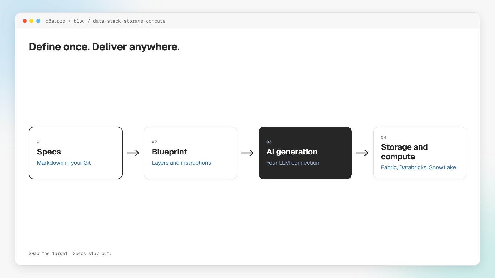
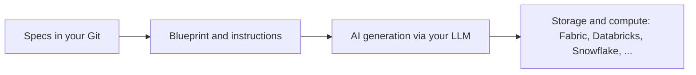
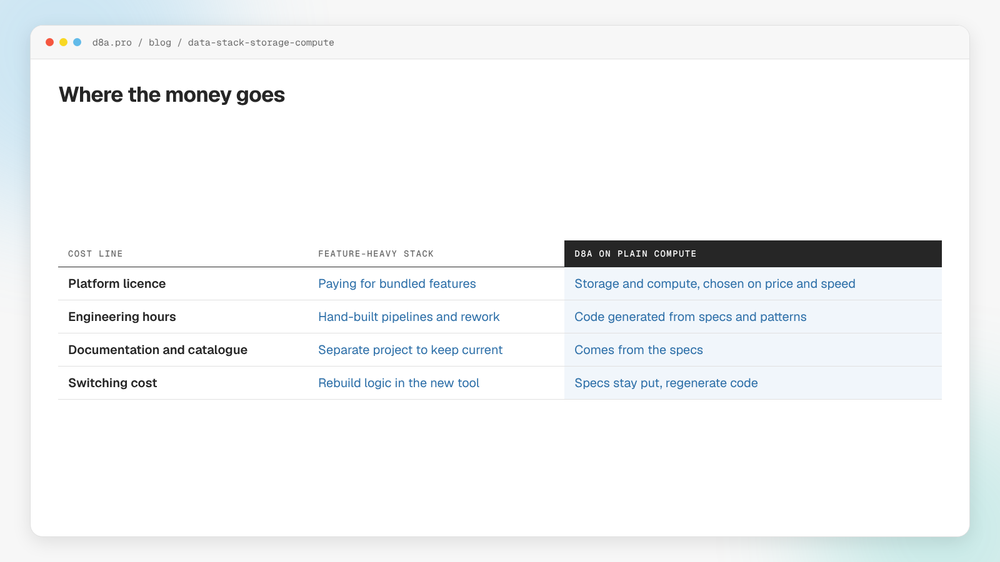

# Data platform cost optimisation: what D8A does to your technological stack

Most data platform decisions are feature comparisons: whose notebooks, whose catalogue, whose AI assistant.
D8A moves those features into specs and your own Git repository, so data platform cost optimisation becomes a simpler question: which storage and compute gives you the best price and performance?

> **TL;DR**
> - In D8A, the durable assets (specs, architecture, generated code) live in your Git repository, outside any platform.
> - Your data platform is reduced to what it does best: store data and run compute. You choose it on cost, speed and fit.
> - Because specs stay put when the target changes, switching or mixing platforms costs less than a rebuild.

<!-- IMAGE PROMPT: Abstract hero for a blog about the data technology stack. Top: a wide ink band representing specs and architecture. Middle: three plain white boxes in a row representing interchangeable compute engines. Bottom: a wide grey tray band representing storage. Clean, minimal, no logos. D8A brand kit v5.0: canvas #F7F7F7, ink #262626, body blue #2D6FA8, chrome dots red/yellow/sky, one hard-stop color frame (sky-deep to yellow), soft ambient orbs, faint infinity watermark, Geist type, no people, no stock, no purple. 1600x900. -->

*Specs on top. Storage and compute underneath.*

## Why data platforms keep getting more expensive

Every major data platform vendor wants to be your entire stack. The D8A positioning names this pain directly: "Every vendor wants to be the entire stack. Switching costs grow."

The pattern is familiar. You adopt a platform for its engine. Then your pipelines, documentation, lineage, access rules and team habits slowly move into its proprietary features. After a few years, the platform's price is no longer the main cost. The main cost is what it would take to leave.

That changes how you negotiate, how you plan, and how freely you can pick the right engine for a workload.

## What changes when specs are the source of truth

In D8A, the assets that make your platform valuable live outside the platform.

- **Specifications:** one Markdown file per Data Object in your Workspace Repo, a Git repository you own on GitHub or Azure DevOps.
- **Data Architecture:** your layers, patterns and instructions, stored as a file in the same repository.
- **Generated code:** plain SQL or dbt, also in your repository.
- **Lineage and documentation:** derived from specs and code, not locked into a platform catalogue.

The platform still does essential work. It stores your data and executes the code. That is exactly the role D8A gives it: storage and compute.

<!-- IMAGE PROMPT: Layered stack diagram on a white card with window chrome. Left grey column titled "Feature-heavy platform": pipelines, docs, lineage, catalogue and storage all inside one vendor box. Right ink column titled "D8A on plain compute and storage": specs, architecture and code in your Git; LLM of your choice; storage and compute from any supported platform. D8A brand kit v5.0, Geist, no purple, no vendor logos. 1600x900. -->

*Where your durable assets live decides who holds the stronger hand in a negotiation.*

## How D8A runs on your existing technology

D8A is not your next data platform. It connects to the platforms you already run and generates code that targets them.

Data Platform Connections exist for PostgreSQL, MySQL, MariaDB, SQL Server, Azure SQL, Azure Synapse, Microsoft Fabric, Snowflake, Databricks, BigQuery, Amazon Redshift, ClickHouse, Oracle, DuckDB, SQLite and Power BI. D8A introspects the platform, generates code in your chosen Code Format, and runs it through Code Execution, isolated per branch in a Branch Schema.

You can also mix platforms in one architecture. The Medallion (Microsoft Fabric) Blueprint, for example, puts bronze in a Lakehouse and silver and gold in a Warehouse, connected by a feed with cross-platform reads.

<!-- IMAGE PROMPT: Flow diagram on a white card with window chrome. Four boxes left to right connected by arrows: "Specs" (sub "Markdown in your Git", highlighted outline), "Blueprint" (sub "Layers and instructions"), "AI generation" (ink box, sub "Your LLM connection"), "Storage and compute" (sub "Fabric, Databricks, Snowflake…"). Caption line "Swap the target. Specs stay put." D8A brand kit v5.0, Geist, no purple. 1600x900. -->

*Define once. Deliver anywhere.*

## Data platform cost optimisation in practice

When the platform is storage and compute, you can compare platforms on the things that drive the bill.

### Choose on price and performance

Engine speed, storage pricing, concurrency and the fit with your cloud contract become the main criteria. Bundled features matter less because your specs, architecture and code do not depend on them.

### Match the engine to the workload

A small departmental mart does not need the same engine as a large event pipeline. With one Blueprint spanning several Data Platforms, each layer can sit where it runs best.

### Switch without a rebuild

D8A's promise is "Define once. Deliver anywhere." When you change the target, your specs and architecture stay put and the code is regenerated for the new platform. You still migrate the data and test the result, but the logic is already written down.

### Keep AI spend inside your contracts

LLM calls go through an LLM Connection you configure, with your own keys. Providers include Azure AI Foundry, Amazon Bedrock, Anthropic, Google AI, OpenRouter, Snowflake Cortex and Databricks model serving. If you choose Cortex or Databricks model serving, prompts are answered by models inside your own Snowflake account or Databricks workspace.

## What does it save?

The amount depends on your platform, contract and workload. The cost lines that move are the same in every estate, and the table below lists them.

<!-- IMAGE PROMPT: Comparison table on a white card with window chrome titled "Where the money goes". Columns: Cost line, Feature-heavy stack, D8A on plain compute (ink header highlight). Rows: Platform licence, Engineering hours, Documentation and catalogue, Switching cost. Short qualitative cells. D8A brand kit v5.0, Geist, canvas #F7F7F7, no numbers, no purple. 1600x900. -->

*You pay for storage and compute on fast, proven technology. The logic stays yours.*

## What this means for your platform partners

None of this makes Microsoft Fabric, Databricks or Snowflake less important. They are excellent at storage and compute, and D8A runs on top of them. The difference is that their role is clear and your intellectual property stays yours.

We compare D8A with each platform in the versus series: [D8A versus Microsoft Fabric](./d8a-vs-microsoft-fabric.md), [D8A versus Databricks](./d8a-vs-databricks.md), [D8A versus Snowflake](./d8a-vs-snowflake.md), [D8A versus Palantir Foundry](./d8a-vs-palantir.md) and [D8A versus dbt](./d8a-vs-dbt.md). For the ownership angle, read [take back control and make your data stack sovereign](./sovereign-data-stack.md).

> [!NOTE]
> **Key takeaway:** Data platform cost optimisation gets easier when your specs, architecture and code live in your own Git. Then you buy storage and compute on price and performance, and switching becomes a migration instead of a rebuild.

## FAQ

### Does D8A replace my data platform?
No. D8A is an AI-powered DataOps workspace. It generates and runs code on the platforms you already use, such as Microsoft Fabric, Databricks or Snowflake.

### Which platforms does D8A support?
D8A has Data Platform Connections for PostgreSQL, MySQL, MariaDB, SQL Server, Azure SQL, Azure Synapse, Microsoft Fabric, Snowflake, Databricks, BigQuery, Amazon Redshift, ClickHouse, Oracle, DuckDB, SQLite and Power BI.

### Can I really switch platforms without rewriting?
Your specs and architecture stay the same and the code is regenerated for the new target. You still migrate the data and validate the output, but the logic does not have to be rediscovered.

### Does D8A see my row-level data?
D8A works on metadata: schemas, lineage, specifications and code. Specs and generated code live in your own Git repositories.

## Read next

- [Take back control and make your data stack sovereign](./sovereign-data-stack.md): who owns your specs, code and LLM.
- [D8A versus Microsoft Fabric](./d8a-vs-microsoft-fabric.md): how D8A runs on top of Fabric.
- [D8A versus Databricks](./d8a-vs-databricks.md): how D8A uses Databricks for storage and compute.

---
**Stop managing process. Start shipping data.** See D8A generate code for the platform you already run.
**[Book a D8A demo](mailto:hello@d8a.pro?subject=D8A%20demo)** · [Join the waitlist](https://d8a.pro/#waitlist) · [Start with the overview: what is D8A?](./what-is-d8a.md)
