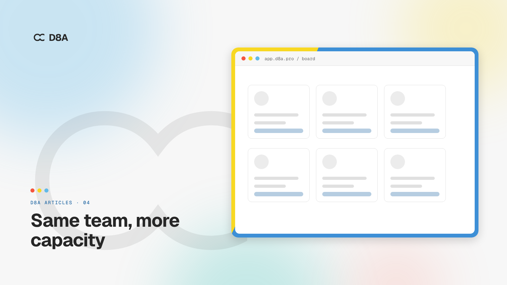
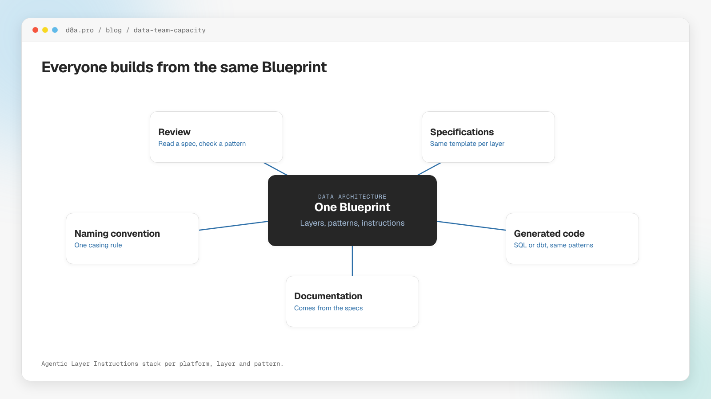
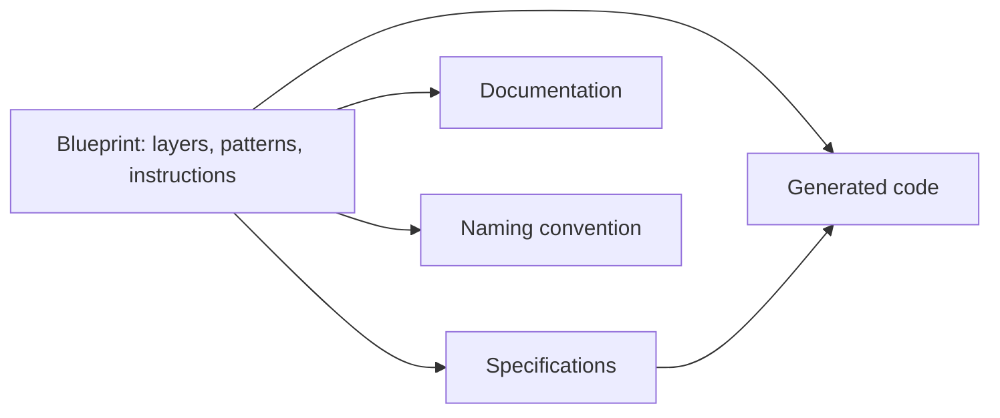
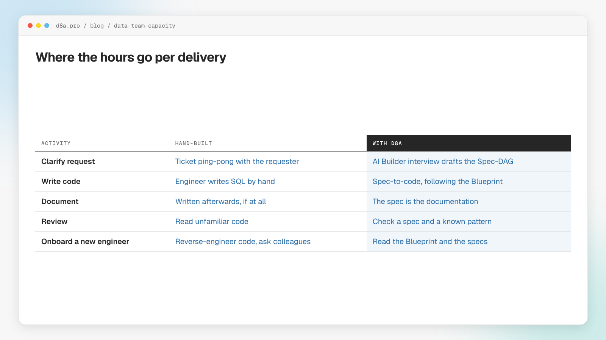
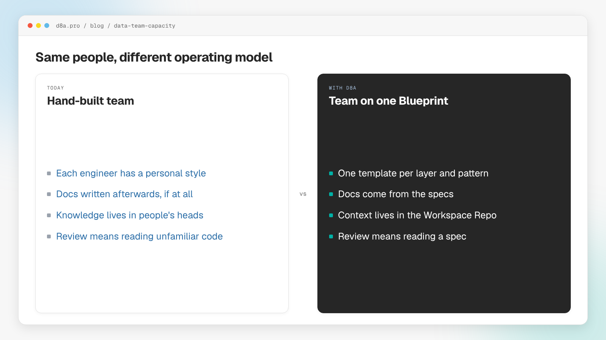

# Data engineering team productivity: what D8A changes for your team

Your backlog grows faster than your headcount, and every new hire learns a slightly different way of building pipelines.
Data engineering team productivity improves when the whole team builds from the same specs, templates and architecture, and D8A is built around that idea.

> **TL;DR**
> - D8A adds capacity by removing process work: boilerplate, rediscovery, handoffs and status updates.
> - The whole team works from one Blueprint, one set of Agentic Layer Instructions and one spec format, so output looks the same no matter who picked up the ticket.
> - Engineers move up the stack: they curate context and review generated code instead of typing it.

<!-- IMAGE PROMPT: Abstract hero for a blog about data team capacity. Six identical white cards in a 3x2 grid, each with a small circle avatar placeholder, two grey lines and a body-blue progress bar, suggesting a team working on identical templates. D8A brand kit v5.0: canvas #F7F7F7, ink #262626, body blue #2D6FA8, window chrome dots red/yellow/sky, one hard-stop color frame (yellow to sky-deep), soft ambient orbs, faint infinity watermark, Geist type, no people, no stock photos, no purple. 1600x900. -->

*One team, one way of building.*

## Where does data team capacity go today?

Ask a Head of Data where the hours go and the answer is rarely "writing transformation logic". The time goes to the work around it.

A request arrives in vague business language. An engineer interviews the requester, reads old code to rediscover how a source behaves, and writes a ticket. Someone else picks it up, builds it in their own style, and a reviewer spends an hour working out which conventions were followed this time.

The D8A positioning names these pains directly: days lost to handoffs, senior time burned on tickets, and architecture rotting in a wiki. None of them is solved by typing faster.

## Why autocomplete does not raise data engineering team productivity

AI coding assistants help one developer write code faster. That is useful, but it speeds up the cheapest part of the job.

The expensive parts stay manual: turning a request into a precise definition, keeping naming and layering consistent, documenting what was built, and checking that the code still matches the intent. D8A manages that lifecycle, from request through specification, code generation, review and merge, against your own architecture.

The D8A FAQ puts it plainly: "It removes process work, not engineers."

## Everyone on the same templates

The biggest capacity gain comes from consistency. In D8A, your team defines the Data Architecture once on the Blueprint canvas: Data Platforms, Data Layers, Data Patterns and the feeds between them.

Each layer and pattern carries Agentic Layer Instructions: Spec Instructions that define what a specification must contain, and Code Instructions that define how code is generated. A Naming Convention and Path Templates sit on top. You can start from a Marketplace Blueprint such as Medallion, Kimball star or Data Vault patterns, then adapt it.

Every generation stacks those instructions in order: platform, then layer, then pattern. The result is that a Gold dimension built on Monday by your newest hire follows the same structure as one built by your lead engineer last year.

<!-- IMAGE PROMPT: Hub diagram on a white card with window chrome. Centre ink box "One Blueprint" with subtitle "Layers, patterns, instructions". Five spokes to white boxes: "Specifications", "Generated code", "Documentation", "Naming convention", "Review checklist". Body-blue connector lines. D8A brand kit v5.0 colours and Geist type, canvas #F7F7F7, no people, no purple. 1600x900. -->

*One Blueprint feeds every artifact the team produces.*

### What changes in day-to-day work

- **Specifying:** the AI Builder interviews the requester in business terms and drafts a Spec-DAG. An engineer reviews it and clicks Confirm specs, which commits the specs to a feature branch with a linked Work Item.
- **Building:** Spec-to-code generates SQL or dbt in your Code Format. Code Execution runs it in an isolated Branch Schema.
- **Reviewing:** reviewers check a spec they can read and code that follows known patterns. A freshness badge flags when spec and code drift apart.
- **Onboarding:** new joiners read specs and the Blueprint instead of reverse-engineering old pipelines.

## How much capacity do you gain?

The gain depends on your team, your stack and how much of your work repeats the same patterns. Where the hours shift is the same everywhere, and the table below shows it per activity.

<!-- IMAGE PROMPT: Comparison table on a white card with window chrome titled "Where the hours go per delivery". Columns: Activity, Hand-built, With D8A (ink header highlight). Rows: Clarify request, Write code, Document, Review, Onboard a new engineer. Short qualitative cells in body blue. D8A brand kit v5.0, Geist and Geist Mono, canvas #F7F7F7, no numbers, no purple. 1600x900. -->

*Effort moves from typing and rediscovery to decisions and review.*

The point is where effort moves. Engineers spend less time on boilerplate, documentation and rediscovery. They spend more time on modelling decisions, edge cases and review. That is the work that changes the numbers for the business.

## Human in command, at the pace you choose

More capacity does not mean less control. D8A lets you set an Automation Mode per column of the delivery board: the agent does the step, the agent does it with human validation, or a human does it.

A cautious team can start with humans validating every generated script. Once the team trusts a pattern, it can move that step to agent with validation, or fully to the agent. Every change keeps a full audit trail from request to production. Human in command. Always.

## What it means for team structure

When code follows from specs, the scarce skill shifts. Engineers who know the business context and can write a precise spec become the bottleneck, in a good way. This is why we describe a new role, the [context owner](./context-owner.md), who owns the specification instead of the code.

It also changes who participates. Because specs are plain Markdown in your Git repository, business people can read and propose changes to them. We explore that in [the impact of D8A on your business](./business-owned-data.md).

And because the team no longer builds bespoke tooling on every platform, your technology choices get simpler. See [the impact of D8A on your technological stack](./data-stack-storage-compute.md).

<!-- IMAGE PROMPT: Side-by-side comparison on a white card with window chrome. Left grey column "Hand-built team": each engineer has own style, docs written afterwards, knowledge in heads, review means reading code. Right ink column "Team on D8A": one Blueprint for everyone, docs come from specs, context in the Workspace Repo, review means reading a spec. D8A brand kit v5.0, Geist, no purple. 1600x900. -->

*Same people, different operating model.*

> [!NOTE]
> **Key takeaway:** Data engineering team productivity grows when the team stops reinventing how to build. One Blueprint, one spec format and AI that follows both turn every engineer's output into the same, reviewable shape.

## FAQ

### Does D8A replace data engineers?
No. The AI drafts specifications, generates code from your patterns and can review and merge, but your team curates the context, sets the automation level and approves the work. It removes process work, not engineers.

### How does D8A keep the whole team consistent?
The Data Architecture on the Blueprint holds Agentic Layer Instructions per layer and pattern, plus a Naming Convention and Path Templates. Every specification and every generated script follows those instructions, whoever starts the work.

### Can we start with full human review?
Yes. Automation Mode is set per board column. You can keep a human on every step and loosen it per pattern as trust grows.

### How long does onboarding take for a new engineer?
It depends on the person and the estate. What changes is the starting point: a new joiner reads the Blueprint and a Markdown spec for every Data Object instead of reverse-engineering code and chasing colleagues.

## Read next

- [Context owner: the new role in the autonomous data platform](./context-owner.md): who owns the spec when code follows from it.
- [What is the impact of D8A on your business?](./business-owned-data.md): how business people take ownership of specs and content.
- [What is the impact of D8A on your technological stack?](./data-stack-storage-compute.md): why storage and compute become the only things you buy.

---
**Stop managing process. Start shipping data.** See how your team would work from one Blueprint and one spec format.
**[Book a D8A demo](mailto:hello@d8a.pro?subject=D8A%20demo)** · [Join the waitlist](https://d8a.pro/#waitlist) · [Start with the overview: what is D8A?](./what-is-d8a.md)
