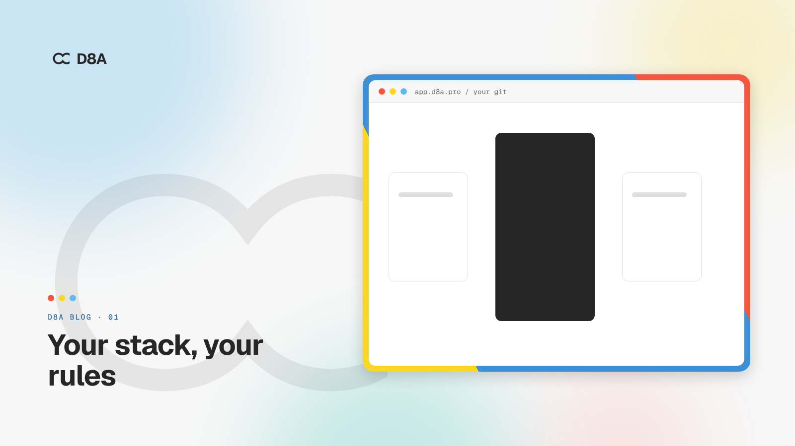
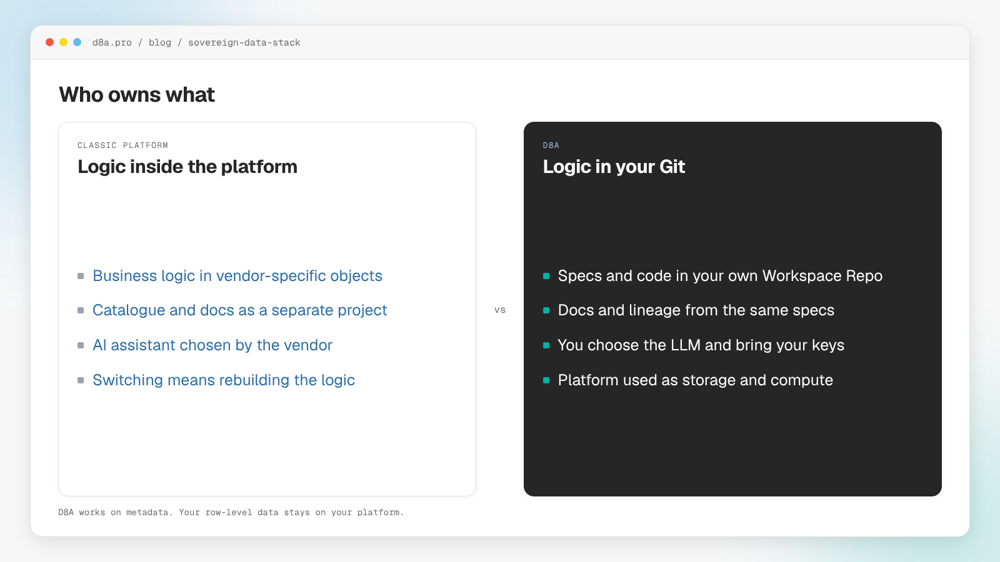
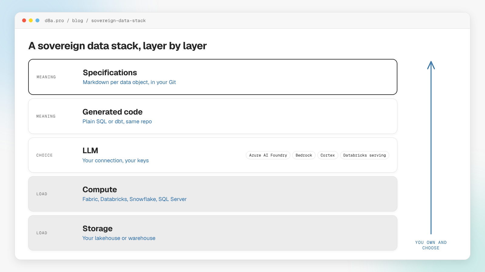
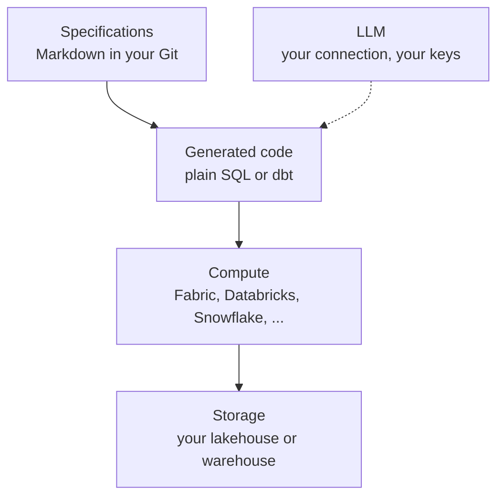

# Sovereign data stack: take back control of specs, code and AI

Ask your platform vendor who owns your business logic, and the honest answer is often "it depends on whether you stay".
A sovereign data stack fixes that: your specifications, your code and your choice of model stay yours, and the platform underneath is storage and compute you can replace.

> **TL;DR**
> - Sovereignty starts with ownership of the layer that carries meaning: specifications and the code generated from them, in your own Git repository.
> - D8A lets you choose the LLM per workspace, including models that run inside your own cloud tenant, with your own keys.
> - When code is generated per platform from the same specs, the platform becomes bare metal you buy on price and performance.

<!-- IMAGE PROMPT: Abstract hero for a blog post about a sovereign data stack. Light canvas #F7F7F7, soft blurred ambient orbs in sky, teal, yellow and faint red. Stroke-only infinity watermark at 8% ink opacity. Right: white window card with chrome dots (red, yellow, sky) and mono URL "app.d8a.pro / your git", inside an abstract composition of a tall ink #262626 column (the owned layer) flanked by two white cards with hairline borders, suggesting a protected core. Hard-stop color frame red, sky-deep, yellow at 245 degrees. Mono eyebrow "D8A blog · 01", Geist bold headline "Your stack, your rules". No people, no flags, no padlocks, no purple. 1600x900. -->

*Sovereignty sits in the layer that carries your business meaning.*

## What makes a sovereign data stack?

Most discussions about data sovereignty stop at where the data is stored. Storage location matters, especially for European companies working under GDPR and sector rules. It is only half of the picture.

The other half is control over the logic: the definitions, transformations and documentation that turn raw tables into answers. If that logic only exists as proprietary artifacts inside one vendor's tooling, moving away means rebuilding it.

For this post, a sovereign data stack meets three tests:

1. You own the specifications and code, in a format and location you control.
2. You choose the AI model that reads and writes that logic.
3. You can swap storage and compute without rewriting the logic.

## Who owns what: a classic platform versus D8A

In a feature-rich platform, much of the value sits in platform-specific objects: notebooks, proprietary pipeline definitions, catalogue entries, semantic layers. They work well. They also tie your business logic to that vendor's way of storing it.

D8A splits the layers differently. Specifications are Markdown files, one per data object, in your Workspace Repo. That repo is a Git repository you own, on GitHub or Azure DevOps today, with GitLab and Bitbucket listed as coming soon. Generated code, plain SQL or dbt, lives next to the specs. The architecture Blueprint is a JSON file in the same repo.

<!-- IMAGE PROMPT: Branded comparison graphic "Who owns what" on a white window card with chrome dots and mono URL. Left column on light grey: "Classic platform", items: business logic inside vendor objects; catalogue and docs as a separate project; AI assistant fixed by the vendor; switching means rebuilding. Right column on ink #262626 with white text and teal bullets: "D8A", items: specs and code in your own Git; docs and lineage from the same specs; you choose the LLM and keys; platform is storage and compute. Geist type, mono tags, soft shadows, canvas #F7F7F7, no purple. -->

*In D8A, the meaning layer lives in your Git, not inside the platform.*

D8A itself works on metadata: schemas, specifications, lineage and code. It does not need your row-level data to do its job. If you delete a D8A Organization, your Git repositories and data platforms stay untouched.

One honest limit: the D8A core platform is not open source, and early access runs as a managed workspace. Self-hosting is on the roadmap for enterprise plans. What is portable today is the work itself: specs, code and architecture, as readable files in your repository.

## How does choosing your own LLM protect sovereignty?

The model that reads your specs and writes your code sees your schemas and business definitions. Who runs that model is a sovereignty question too.

In D8A, an LLM Connection is just another connection. The provider registry includes OpenRouter, Anthropic, Azure AI Foundry, Amazon Bedrock, Google AI, Snowflake Cortex and Databricks model serving. You bring your own API key or credentials, stored in the Secret Store. That store supports bring-your-own-key encryption with your AWS KMS, GCP KMS or Azure Key Vault.

Three options matter most for European teams:

- **Azure AI Foundry** endpoints sit in your own Azure resource, in the region you pick.
- **Amazon Bedrock** runs in the AWS region you configure.
- **Snowflake Cortex** and **Databricks model serving** answer prompts with models inside your own Snowflake account or Databricks workspace.

AI Workflows in D8A never reference a model by name. They reference Model Roles (general purpose, classifier, embedding), which you map to the models of your choice. Switching models is a configuration change. [NEED: confirm EU hosting region commitment for the D8A managed workspace]

## The layered view: specs, code, LLM, storage and compute

Seen as layers, a sovereign data stack separates what carries meaning from what carries load.

<!-- IMAGE PROMPT: Branded layered schematic on a white window card with chrome dots. Five horizontal bands from top to bottom: "Specifications" (Markdown per data object, in your Git) highlighted with ink outline; "Generated code" (plain SQL or dbt, same repo); "LLM" (your connection, your keys; chips: Azure AI Foundry, Bedrock, Cortex, Databricks serving); "Compute" (Fabric, Databricks, Snowflake, SQL Server); "Storage" (your lakehouse or warehouse) on grey tray. Side arrow labelled "you own and choose" pointing up. Geist type, mono tags, body blue subtext, canvas #F7F7F7, no purple, no people. -->

*The top three layers carry your meaning. The bottom two carry load.*

The top layer is the durable one. [Specs are the new code](./specs-are-the-new-code.md) explains why the specification, not the code, is the asset worth owning. The second layer is generated, so you can regenerate it. The [AI acts as a compiler](./ai-is-your-next-compiler.md) between the two, and you choose which one.

The bottom layers are where your platform vendor shines. D8A treats them as bare metal: [compute and storage you pick on price and performance](./data-stack-storage-compute.md) instead of on bells and whistles.

## Can you swap platforms without starting over?

D8A generates code per Data Platform, following the Agentic Layer Instructions you set for each platform, layer and pattern. Supported connections include PostgreSQL, MySQL, MariaDB, SQL Server, Azure SQL, Azure Synapse, Microsoft Fabric, Snowflake, Databricks, BigQuery, Amazon Redshift, ClickHouse, Oracle, DuckDB, SQLite and Power BI.

Because specifications describe intent instead of dialect, the same spec can drive code for a different target. Define once. Deliver anywhere. A migration still needs testing, data movement and review. It no longer needs rediscovery of what each table means. [NEED: real example or measured effort of a platform switch with D8A]

## Sovereignty without picking a fight with your vendor

A sovereign data stack does not mean leaving Microsoft Fabric, Databricks or Snowflake. Microsoft and Databricks are technology partners of Plainsight, and D8A runs on top of these platforms. The point is that the choice stays yours.

The comparison posts look at each platform in detail:

- [D8A vs Microsoft Fabric](./d8a-vs-microsoft-fabric.md)
- [D8A vs Databricks](./d8a-vs-databricks.md)
- [D8A vs Snowflake](./d8a-vs-snowflake.md)
- [D8A vs Palantir Foundry](./d8a-vs-palantir.md)
- [D8A vs dbt](./d8a-vs-dbt.md)

> [!NOTE]
> **Key takeaway:** A sovereign data stack keeps meaning and load apart. Own the specs and code in your Git, choose the model that reads them, and treat the platform as storage and compute you can replace.

## FAQ

### What is a sovereign data stack?
A sovereign data stack is one where you control the business logic, the AI that works on it and the choice of platform. With D8A, specifications and generated code live in your own Git repository, and the platform is used for storage and compute.

### Does D8A store my data?
D8A works on metadata such as schemas, specifications, lineage and code, not on row-level data. Your data stays on your own platform.

### Can I use an LLM that runs in my own cloud tenant?
Yes. D8A supports Azure AI Foundry, Amazon Bedrock, Snowflake Cortex and Databricks model serving, among others, with your own credentials. Models are mapped to roles, so you can change them without changing workflows.

### Can I self-host D8A?
Not today. Self-hosting is on the roadmap for enterprise plans, and early access runs as a managed workspace. Your specs and code are already portable files in your own repository.

## Read next

- [Specs are the new code](./specs-are-the-new-code.md): why the specification is the asset to own.
- [What D8A changes in your technology stack](./data-stack-storage-compute.md): buying platforms as plain storage and compute.
- [AI is your next compiler](./ai-is-your-next-compiler.md): how the model you choose turns specs into code.

---
<!-- NEED: replace with demo booking URL when live -->
**Stop managing process. Start shipping data.** See where your specs, code and model choice live in a D8A workspace.
**[Book a D8A demo](https://d8a.pro/#waitlist)** · [Start with the overview: what is D8A?](./what-is-d8a.md)
