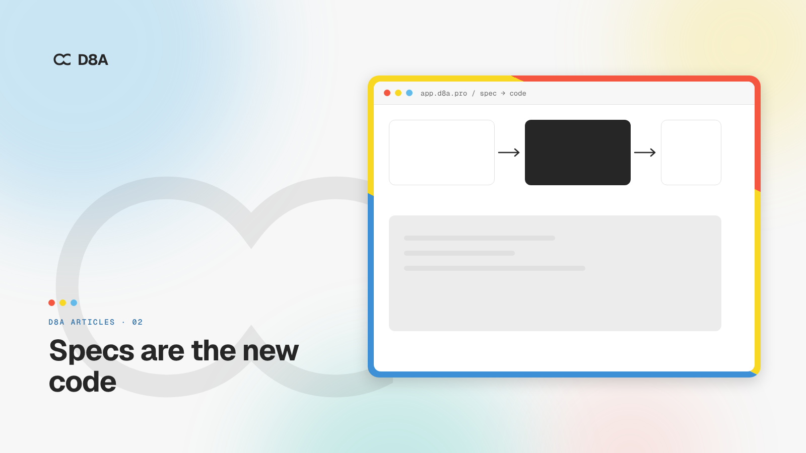
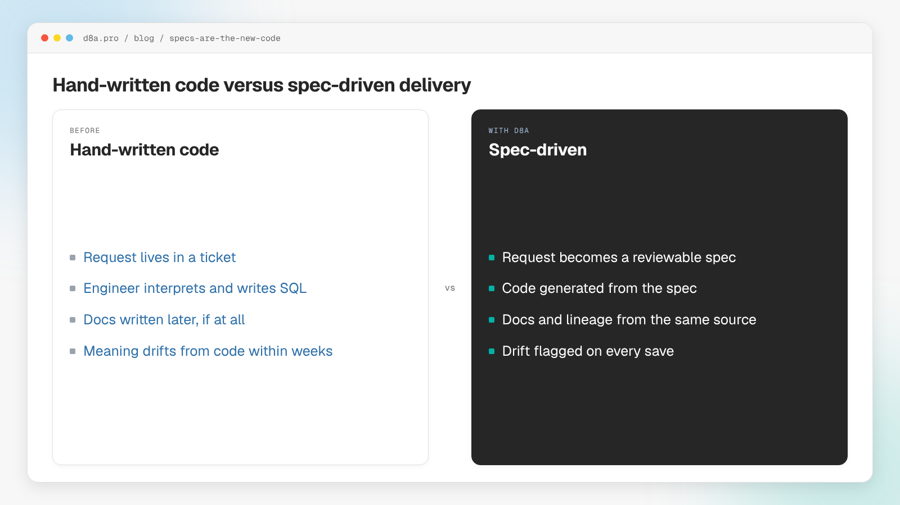
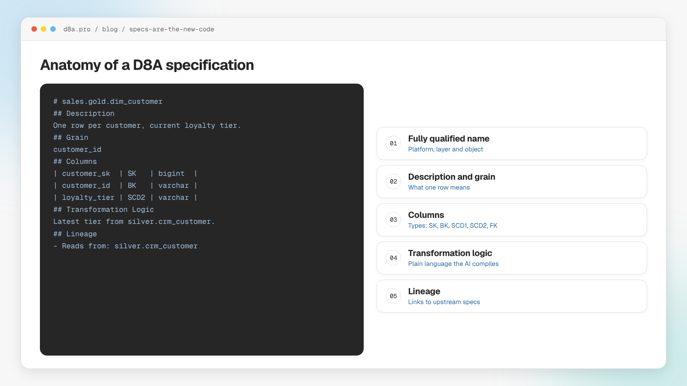

# Specs are the new code: spec-driven data engineering explained

Your SQL knows how a customer table is built. It has no idea why, who asked for it, or what "active customer" means this quarter.
Spec-driven data engineering moves that knowledge into a specification that people can read, review and own, and lets the code follow.

> **TL;DR**
> - In spec-driven data engineering, each data object has a specification that states its meaning, grain, columns, logic and lineage. That spec is the source of truth.
> - Code is generated from the spec and validated against it. When the two drift, you see it.
> - The spec becomes the place where business and engineering meet, and the basis for documentation, catalogue and lineage.

<!-- IMAGE PROMPT: Abstract hero for "Specs are the new code". Light canvas #F7F7F7 with soft blurred orbs in sky, teal, yellow and faint red. Stroke-only infinity watermark at 8% ink. Right: white window with chrome dots and mono URL "app.d8a.pro / spec → code", containing an abstract flow: white card, ink card, white card with arrows, above a grey tray with placeholder lines like a document. Hard-stop color frame red, yellow, sky-deep at 205 degrees. Mono eyebrow "D8A articles · 02", Geist bold headline "Specs are the new code". No people, no purple. 1600x900. -->

*The durable asset is the specification. Code follows.*

## What is spec-driven data engineering?

Spec-driven data engineering is a way of building data platforms where you write and maintain specifications, and code is derived from them. The spec is the contract between what the business asked for and what runs in production.

That reverses the usual order. In most teams, code comes first and documentation comes later, if at all. Meaning lives in ticket comments, in someone's head and in a wiki page last edited two reorganisations ago.

D8A's founding decision is written down in its own architecture records: specs are the new code. The specification is the durable, reviewable, per-object definition in your repository. Code is generated from it and validated against it.

## Hand-written code versus spec-driven delivery

Here is how a single request travels through both models.

<!-- IMAGE PROMPT: Branded before/after comparison on a white window card with chrome dots and mono URL. Left column on light grey titled "Hand-written code", items: request lives in a ticket; engineer interprets and writes SQL; docs written later, if at all; meaning drifts from code within weeks. Right column on ink #262626 titled "Spec-driven", white text with teal bullets: request becomes a reviewable spec; code generated from the spec; docs and lineage from the same source; drift flagged on every save. Geist type, mono tags, canvas #F7F7F7, no purple, no people. -->

*Same request, two paths. Only one keeps meaning and code together.*

In the hand-written model, the engineer is the translator. Every handoff loses detail. When the logic changes, someone updates the SQL and maybe the docs.

In the spec-driven model, the translation is explicit and reviewable. A business user describes the need in plain language. D8A's AI Builder interviews them in business terms and drafts a Spec-DAG: the data objects needed and how they connect. When the team presses Confirm specs, each object gets a specification on a feature branch, linked to a Work Item.

From there, Spec-to-code generates the implementation. The [AI acts as a compiler](./ai-is-your-next-compiler.md) that reads your specs and your architecture rules.

## What does a data specification look like?

In D8A, a specification is a Markdown file, one per data object. It lives in your Workspace Repo at a predictable path: spec folder, data platform, data layer, then the fully qualified name.

The sections come from the Agentic Layer Instructions of the layer or pattern the object belongs to. A gold dimension in the Medallion blueprint, for example, asks for a fully qualified name, description, grain, SQL dialect, columns, transformation logic, lineage and notes.

<!-- IMAGE PROMPT: Branded "anatomy of a spec" graphic on a white window card with chrome dots. Left: an ink #262626 code panel in Geist Mono showing a Markdown spec: "# sales.gold.dim_customer", "## Description", "One row per customer with current loyalty tier.", "## Grain", "customer_id", "## Columns", "| customer_sk | SK | bigint |", "| customer_id | BK | varchar |", "| loyalty_tier | SCD2 | varchar |", "## Lineage", "- Reads from: silver.crm_customer". Headings in sky #61BAE9. Right: five numbered callout cards with mono number badges: name, description, grain, columns with column types, lineage. Canvas #F7F7F7, no purple. -->

*A D8A spec: plain Markdown that people and the AI can both read.*

The columns table carries more than names and types. Each column gets a column type such as SK (surrogate key), BK (business key), SCD1, SCD2, FK or TC, plus precision and column-level transformations. Lineage lines point to the specs of upstream objects, so the graph is navigable as plain links.

Because it is Markdown in Git, a spec gets the same treatment as code. It has branches, pull requests, review and history. There is no separate documentation tool to keep in sync.

## How does a spec stay the single source of truth for data?

A source of truth is only useful if it stays true. D8A checks this in a few ways:

- **Freshness badge.** Each object shows whether spec and code are in sync. You see drift before it causes an incident.
- **Validation on save.** When you edit the spec or the code, D8A proposes the matching change on the other side.
- **Pre-flight checks.** Generation refuses to run when the target platform is unknown.
- **Code-to-Spec.** For existing code, D8A can write the spec from the code, so you can adopt the approach on a running platform.

Rename and drop changes go through a reviewed migration step. Generated plain SQL is idempotent and additive, so regenerating code does not quietly destroy a column.

## Why spec-driven data engineering changes who does what

Once the spec is the asset, the people who know the business context matter as much as the people who write code. Someone has to own what "active customer" means. In this series we call that person [the context owner](./context-owner.md).

Engineers do not disappear. They design the architecture, write the layer and pattern instructions, review generated code and handle what the AI cannot. D8A removes process work, not engineers.

Specs also carry the information a data catalogue tries to collect after the fact: descriptions, grain, column meaning and lineage. That is why we argue you can [skip the classic catalogue project](./data-catalogue-alternative.md) when everything starts from a spec.

> [!NOTE]
> **Key takeaway:** Treat the specification as the product. When meaning lives in a reviewed spec and code is generated from it, drift becomes visible and documentation stops being a separate job.

## FAQ

### What is the difference between a spec and documentation?
Documentation describes code after it is written. A spec in D8A comes first, and code is generated from it and validated against it, so the two cannot quietly drift apart.

### What format does a D8A specification use?
Each spec is a Markdown file per data object, stored in your own Git repository. Its sections follow the instructions of the data layer or pattern, such as description, grain, columns, transformation logic and lineage.

### Can I use spec-driven data engineering on an existing platform?
Yes. D8A can generate specs from existing code with Code-to-Spec and from tables it introspects on your platform. You can adopt the approach object by object.

### Who writes the specs?
Business users describe what they need in plain language, and D8A's AI Builder drafts the specs. Engineers and context owners review and confirm them before code is generated.

## Read next

- [AI is your next compiler](./ai-is-your-next-compiler.md): how specs turn into working pipelines.
- [Context owner: the new role in the autonomous data platform](./context-owner.md): who owns the meaning in a spec.
- [D8A versus a data catalogue](./data-catalogue-alternative.md): why the catalogue becomes a by-product of specs.

---
**Stop managing process. Start shipping data.** Watch a plain-language request become a reviewed spec and generated code.
**[Book a D8A demo](mailto:hello@d8a.pro?subject=D8A%20demo)** · [Join the waitlist](https://d8a.pro/#waitlist) · [Start with the overview: what is D8A?](./what-is-d8a.md)
