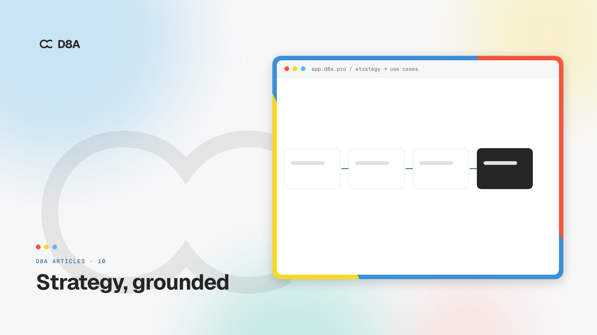
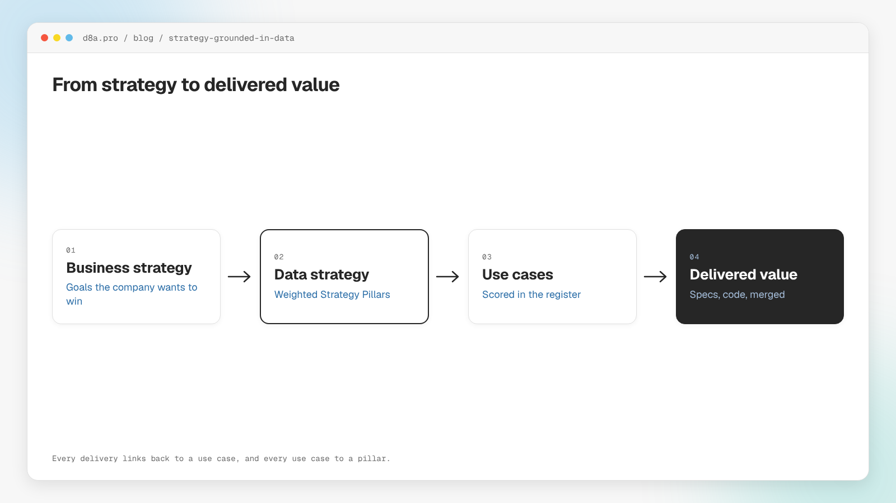
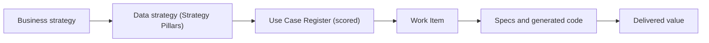
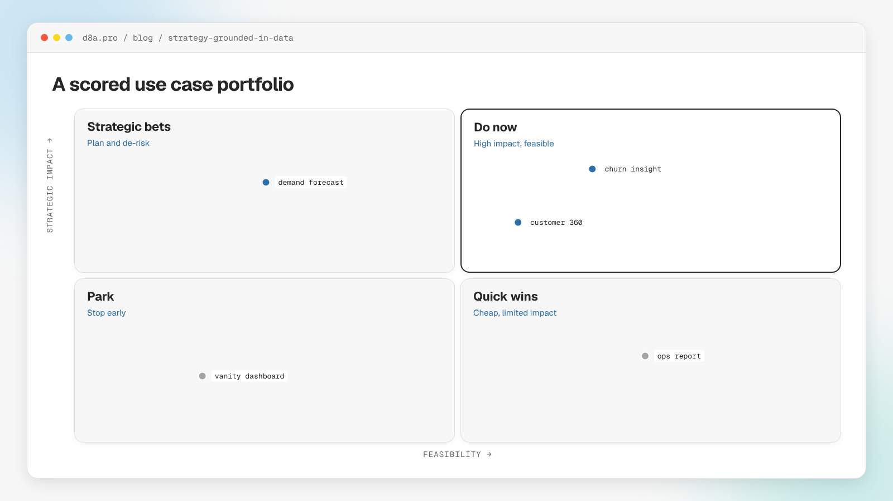

# Strategy grounded in your own data: align data strategy with business strategy

No more unrealistic wish lists. All wishes grounded in your data truth.
To align data strategy with business strategy, every use case needs a visible line back to a pillar, and forward to what got delivered.

> **TL;DR**
> - Most data roadmaps are funded by the loudest request, so strategy and delivery drift apart.
> - D8A links Strategy Pillars, scored Use Cases and the Work Items that deliver them in one workspace.
> - Because specs and code sit at the end of the same chain, you can trace delivered pipelines back to the strategy they serve.

<!-- IMAGE PROMPT: Abstract hero for a blog about aligning data strategy with business strategy. Light canvas #F7F7F7 with blurred ambient orbs. Right side: white app window with chrome dots (red, yellow, sky), mono URL "app.d8a.pro / strategy → use cases", inside four nodes in a row linked by body blue arrows, the last node dark ink, suggesting a lineage from strategy to delivery. One hard-stop frame (red, sky-deep, yellow). Left: eyebrow "D8A articles · 10" and the words "Strategy, grounded" in Geist Bold ink. Faint infinity watermark. No people, no purple. -->

*From business strategy to delivered pipelines, in one chain.*

## Why data roadmaps drift from strategy

Every year the business writes a strategy. Every year the data team gets a list of requests. The two documents rarely reference each other.

The result is predictable. Budget follows whoever escalates first. Low-value dashboards get built while the use cases that would move a strategic pillar wait. Six months later nobody can say which delivered pipeline served which goal.

The wish list problem has a second side. Ideas get approved without checking whether the data exists. A use case that looks great on a slide stalls when the team finds the source system holds half the needed fields.

## How to align data strategy with business strategy

Alignment needs three things that most organisations keep in separate places: the strategy, a scored portfolio of use cases, and the delivery work. D8A keeps them in one workspace and links them.

**1. Strategy Pillars.** The Business Strategy Coach and the Data Strategy Coach interview you and turn the answers into a Data Strategy with weighted Strategy Pillars. These are the goals the company is trying to win.

**2. Scored use cases.** Each Use Case is scored 0 to 5 per pillar, plus impact, feasibility and size. All use cases sit in the Use Case Register, ranked by one score, so a pet project and a strategic bet are judged the same way.

**3. Delivery.** An adopted Use Case links to a Work Item on the delivery board. From there it moves into [living specifications](./specs-are-the-new-code.md), generated code, review and merge.

<!-- IMAGE PROMPT: Lineage flow diagram in D8A brand style on a white window card with chrome dots. Four nodes in a row with arrows: "Business strategy" (sub "Goals the company wants to win"), "Data strategy" (sub "Weighted Strategy Pillars", highlighted border), "Use cases" (sub "Scored in the Use Case Register"), "Delivered value" (dark ink, sub "Specs, code, merged"). Geist type, mono tags 01 to 04. No purple. -->

*Each step references the one before it, so you can trace delivery back to a pillar.*

## Grounded in your data truth

Scoring a use case on strategic fit is half the job. The other half is checking it against the data you have.

D8A introspects your data platform and catalogues every Data Object with a specification. When a use case is adopted, the request is drafted as specs grounded in your architecture and existing data structures. Gaps show up early, in the spec, before an engineer spends a sprint discovering them.

D8A can also suggest use cases you have not built yet. Suggested Use Cases come from the AI, based on your strategy. You can add your own through the Use Case Assistant. Both land in the same register, scored on the same criteria. AI suggestions are optional.

The result is a portfolio of wishes that each passed two tests: does it serve the strategy, and does the data support it? Every Use Case gets a score from 0 to 5 per Strategy Pillar, plus impact, feasibility and size, so the register ranks them on the same scale.

## Keep the portfolio in line as strategy changes

Strategies change. A new CEO, a market shift, an acquisition. In most organisations the data roadmap catches up a year later.

When use cases are scored against weighted pillars, a change in weights re-ranks the register. You see which projects lost their reason to exist and which ones moved up. That makes it easier to stop low-value work early, which is the cheapest saving a data team can make.

<!-- IMAGE PROMPT: 2x2 portfolio matrix in D8A brand style on a white window card with chrome dots. X axis "Feasibility", Y axis "Strategic impact". Quadrants: top-left "Strategic bets", top-right "Do now" (highlighted ink border), bottom-left "Park", bottom-right "Quick wins". Dots: body blue for strategy-aligned use cases, grey for others, with small mono labels such as "churn insight", "customer 360", "vanity dashboard". Geist type. -->

*A scored register makes the trade-offs visible. Example labels only.*

## Lineage from strategy to code

Data teams know lineage as table-to-table. D8A extends the idea upward. A merged pipeline traces back to its specs, the specs to a Work Item, the Work Item to a Use Case, and the Use Case to the pillars it scores on.

That chain answers the questions boards ask: what did we deliver for pillar X this quarter, and what is still waiting? It also helps the [business take ownership of its data](./business-owned-data.md), because the people who set the strategy can see where it lands.

The meaning in that chain needs an owner. [Context owners](./context-owner.md) keep the definitions in the specs aligned with how the business talks, so "customer" in the strategy and "customer" in the gold layer are the same thing.

> [!NOTE]
> **Key takeaway:** strategy stays aligned when every use case is scored against the same pillars and every delivery links back to a use case. Put strategy, portfolio and specs in one chain.

## Where to start

You do not need a perfect strategy document. Start with the three to five goals leadership already talks about, and turn them into weighted pillars. Score your current backlog against them. The first ranking is usually enough to stop one or two projects and speed up one that matters.

Then route new requests through the register. Every idea gets scored before it gets built. That is how a wish list turns into a portfolio. For the full picture of how strategy, specs and architecture connect, read [what is D8A](./what-is-d8a.md).

## FAQ

### How do you align data strategy with business strategy?

Translate business goals into a small set of weighted pillars, score every data use case against them, and link delivery work to the scored use cases. When all three live in one place, you can see which deliveries serve which goal. D8A does this with Strategy Pillars, the Use Case Register and Work Items.

### What is a Use Case Register?

It is the list of all data and analytics use cases in a D8A workspace. Each use case is scored per strategy pillar, plus impact, feasibility and size, and ranked by one score. An adopted use case links to a Work Item for delivery.

### Can D8A suggest use cases?

Yes. D8A can propose Suggested Use Cases based on your strategy, and you can add your own through the Use Case Assistant. Both are scored on the same criteria, and suggestions are optional.

### What happens when the strategy changes?

You update the pillars and their weights. Because use cases are scored per pillar, the register re-ranks, and you can see which projects lost priority and which ones gained it.

## Read next

- [What is the impact of D8A on your business?](./business-owned-data.md): how business teams get involved through specs and content.
- [Context owner: the new role in the autonomous data platform](./context-owner.md): who keeps definitions aligned from strategy to gold layer.
- [What is D8A?](./what-is-d8a.md): the full cascade from strategy to specs to code.

---
**Stop managing process. Start shipping data.** See your own strategy pillars turned into a scored use case register.
**[Book a D8A demo](mailto:hello@d8a.pro?subject=D8A%20demo)** · [Join the waitlist](https://d8a.pro/#waitlist) · [Start with the overview: what is D8A?](./what-is-d8a.md)
