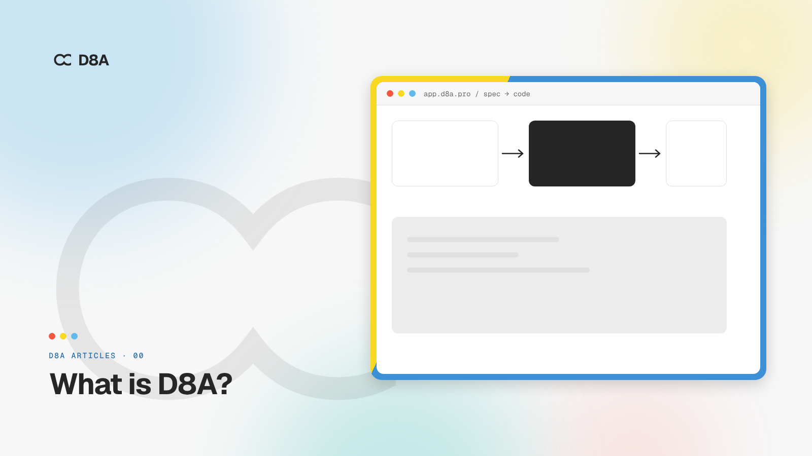
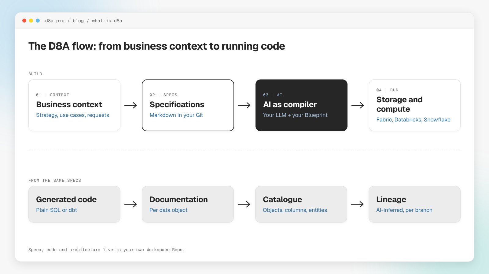
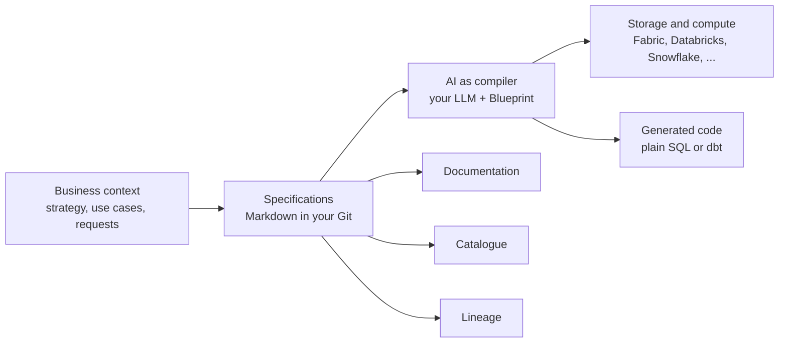
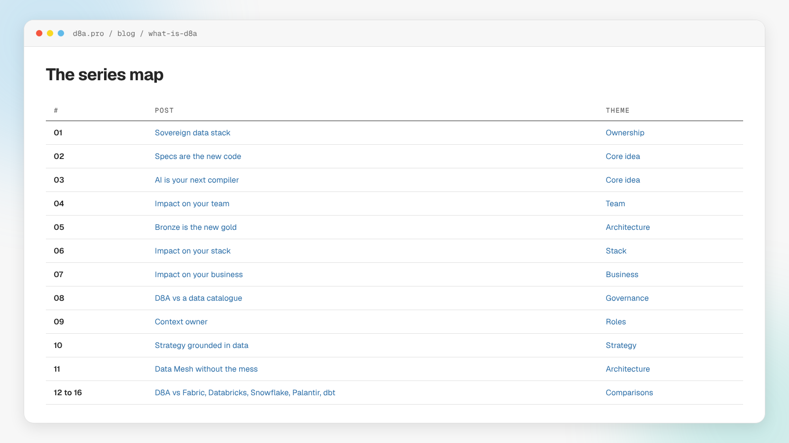

# What is D8A? The spec-driven data platform, explained

Most data teams still turn a business question into production code the way they did in 2018: a ticket, a meeting, a hand-written pipeline, a wiki page nobody updates.
D8A is a spec-driven data platform that replaces that chain with one durable asset, the specification, and lets AI generate the rest on the stack you already run.

> **TL;DR**
> - In D8A, the specification is the single source of truth. Code, documentation, catalogue and lineage follow from it.
> - AI acts as the compiler: it reads your specs and your architecture instructions and generates SQL or dbt for your platform, with humans approving at the level you choose.
> - Your stack becomes storage and compute. Your business owns the context. Specs and code live in your own Git repository.

<!-- IMAGE PROMPT: Abstract hero for a blog pillar page about a spec-driven data platform. Light canvas #F7F7F7 with soft blurred ambient orbs in sky #61BAE9, teal #00B1A6, yellow #F8D823 and a faint red #F5563F. Large stroke-only infinity mark watermark at 8% ink opacity on the left. Right side: a white product-style window with three chrome dots (red, yellow, sky) and mono URL "app.d8a.pro / spec → code", inside an abstract flow of three cards (white, ink #262626, white) connected by ink arrows above a grey tray panel. Hard-stop color frame yellow to sky-deep at 115 degrees. Small mono eyebrow "D8A articles · 00" and Geist bold headline "What is D8A?". No people, no stock imagery, no purple. 1600x900. -->

*One durable asset, the specification, drives everything downstream.*

## What is a spec-driven data platform?

A spec-driven data platform treats the specification as the product and the code as its output. You describe each data object once: what it means, its grain, its columns, where it reads from and how it transforms. The platform generates the code that implements it and checks that code against the spec.

D8A describes itself as an AI-powered DataOps (Data Operations) workspace. It covers the data engineering lifecycle from business strategy and data requests through specifications, code generation, review and merge. It does this on your stack, without becoming another storage or compute layer.

D8A is not your next data platform technology. It works on metadata: schemas, specifications, lineage and code. Your row-level data stays where it is.

## How D8A works, from business context to running code

The D8A flow has four stages. Each one hands a clear artifact to the next.

1. **Business context.** Strategy Pillars, scored Use Cases and plain-language requests describe what the business is trying to achieve.
2. **Specifications.** D8A's AI Builder interviews the requester and drafts a Spec-DAG: the set of data objects needed and how they connect. When you press Confirm specs, each object gets a Markdown Specification on a feature branch in your Workspace Repo.
3. **AI as compiler.** Spec-to-code generates plain SQL or dbt for the target platform. It follows the Agentic Layer Instructions you defined for each Data Layer and Data Pattern in your Blueprint.
4. **Storage and compute.** Code Execution runs the result on your platform, in an isolated Branch Schema for dbt builds, before review and merge.

<!-- IMAGE PROMPT: Branded architecture schematic of the full D8A flow on a white window card with chrome dots and mono URL "d8a.pro / blog / what-is-d8a". Four cards left to right joined by ink arrows: "Business context" (strategy, use cases, requests), "Specifications" (Markdown in your Git, highlighted with ink outline), "AI as compiler" (ink fill, your LLM and your Blueprint), "Storage and compute" (Fabric, Databricks, Snowflake and more). A second row beneath shows outputs fanning from the specification: "Generated code", "Documentation", "Catalogue", "Lineage". D8A brand kit v5.0: canvas #F7F7F7, ink #262626, body blue #2D6FA8, Geist type, soft shadows, no purple, no people. -->

*The D8A flow: context becomes specs, specs become code, your platform runs it.*

The loop also runs backwards. Code-to-Spec writes specifications for code that already exists, and D8A can generate specs for tables it introspects on your platform. You do not need a greenfield project to start.

## Why specs are the new code

Code is a poor place to keep business meaning. It is written for machines, it is spread across repositories, and it drifts from what the business asked for within weeks.

A specification is written for people. In D8A it is a Markdown file per data object with sections such as Description, Grain, Columns, Transformation Logic and Lineage. Business users can read it. Engineers can review it. The AI can generate from it.

D8A keeps both sides honest. A freshness badge flags when spec and code drift apart. When you save one side, D8A proposes the matching change on the other. The [full argument for specs as the source of truth](./specs-are-the-new-code.md) is in post 2 of this series.

## Where the AI fits: a compiler you control

Compilers turned source code into machine code, and engineers stopped writing assembly. D8A applies the same idea one level up: [AI translates specifications into pipelines](./ai-is-your-next-compiler.md).

Two things keep that compiler predictable. First, your architecture. You define layers, patterns, naming conventions and code instructions once in the Blueprint, or start from a Marketplace blueprint such as Medallion, Data Vault or Kimball star. Every generation stacks those instructions in order: platform, then layer, then pattern.

Second, human command. Automation Mode is set per column of the delivery board: agent, agent with human validation, or human. Human in command. Always. It removes process work, not engineers.

You also choose the model. An LLM Connection can point to OpenRouter, Anthropic, Azure AI Foundry, Amazon Bedrock, Google AI, Snowflake Cortex or Databricks model serving, with your own keys.

## What D8A changes for your team, stack, business and strategy

A spec-driven approach shifts work across four areas. Each has its own post in this series.

<!-- IMAGE PROMPT: Branded table graphic "The series map" on a white window card with chrome dots. Columns: "#", "Post", "Theme". Rows list all sixteen posts of the series: 01 Sovereign data stack, 02 Specs are the new code, 03 AI is your next compiler, 04 Impact on your team, 05 Bronze is the new gold, 06 Impact on your stack, 07 Impact on your business, 08 D8A vs a data catalogue, 09 Context owner, 10 Strategy grounded in data, 11 Data Mesh without the mess, 12 to 16 D8A versus Fabric, Databricks, Snowflake, Palantir, dbt. Geist type, mono column headers, hairline rules, body blue text, ink header rule, canvas #F7F7F7, no purple. -->

*The series map: one pillar, eleven themes, five comparisons.*

### Your team

When every engineer generates from the same Blueprint, the same templates and the same naming rules, output stops depending on who picked up the ticket. Read [what D8A changes for your data team](./data-team-capacity.md) and why [the context owner](./context-owner.md) becomes a central role.

### Your stack

If code is generated for your platform and specs stay put, the platform becomes plain storage and compute. You choose it on price and performance. See [what that means for your technology stack](./data-stack-storage-compute.md) and how to [take back control with a sovereign data stack](./sovereign-data-stack.md).

### Your business

Business users describe what they need in plain language and read the resulting spec. Every person is a data person. Read [what changes when the business owns the context](./business-owned-data.md).

### Your strategy

D8A starts from business strategy. Strategy Pillars score every Use Case in the Use Case Register on impact and feasibility, and an adopted Use Case links to delivery. Read how to [ground your strategy in your own data](./strategy-grounded-in-data.md).

## Medallion, catalogues and Data Mesh, through a spec lens

Three familiar data topics look different once specs carry the context.

- **Medallion architecture.** A documented bronze layer gives every downstream model a known starting point. [Bronze is the new gold](./bronze-is-the-new-gold.md) explains why.
- **Data catalogues.** When each object has a living spec and AI-inferred lineage, the catalogue is a by-product. Compare that with a classic programme in [D8A versus a data catalogue](./data-catalogue-alternative.md).
- **Data Mesh.** A central architecture, copied into domain workspaces, lets business units build their own data products within your guidelines. See [Data Mesh without the mess](./data-mesh-without-the-mess.md).

## How does D8A compare with Fabric, Databricks, Snowflake, Palantir and dbt?

D8A generates code that runs on these platforms. In most cases it sits on top of them instead of replacing them.

The versus posts compare approach, ownership, lock-in, LLM choice, documentation and cost model:

- [D8A vs Microsoft Fabric](./d8a-vs-microsoft-fabric.md)
- [D8A vs Databricks](./d8a-vs-databricks.md)
- [D8A vs Snowflake](./d8a-vs-snowflake.md)
- [D8A vs Palantir Foundry](./d8a-vs-palantir.md)
- [D8A vs dbt](./d8a-vs-dbt.md)

D8A supports PostgreSQL, MySQL, MariaDB, SQL Server, Azure SQL, Azure Synapse, Microsoft Fabric, Snowflake, Databricks, BigQuery, Amazon Redshift, ClickHouse, Oracle, DuckDB, SQLite and Power BI as data platform connections. Define once. Deliver anywhere.

## Who owns what in D8A?

Ownership is where a spec-driven platform differs most from a classic one.

| Asset | Where it lives | Who owns it |
|---|---|---|
| Specifications | Markdown files in your Workspace Repo | You |
| Generated code | Same repo, plain SQL or dbt | You |
| Architecture (Blueprint) | JSON file in your repo | You |
| Business context (Ontology, Use Cases) | Your repo and workspace | You |
| LLM | Your LLM Connection, your keys | You choose |
| Row-level data | Your data platform | Stays on your platform |

The Workspace Repo is a Git repository owned by the customer, on GitHub or Azure DevOps today, with GitLab and Bitbucket listed as coming soon. Deleting a D8A Organization leaves your repositories and data platforms untouched. The core platform is not open source, and early access runs as a managed workspace.

## What D8A is not

Clear boundaries help when you explain D8A to your CIO or your platform team.

D8A is not an autocomplete for SQL. Tools such as Copilot or Cursor help one developer type faster. D8A manages the lifecycle from request to merge, following your architecture instructions.

D8A is not a BI tool or an ETL platform. It generates the models and pipelines that your existing tools and platforms run. Power BI semantic models and Fabric Data Factory pipelines are among its outputs.

D8A is not a lock-in play. The specification format and the generated code live in your own Git repositories, readable and portable. If your target platform changes, your specs and architecture stay put.

And D8A is not a replacement for your engineers. The people who know your platform write the instructions the AI follows, review what it produces and decide how much it may do on its own.

> [!NOTE]
> **Key takeaway:** D8A turns the specification into your durable data asset. Code, documentation and lineage follow from it, your platform runs it, and both specs and code stay in your own Git.

## FAQ

### What is D8A in one sentence?
D8A is an AI-powered DataOps workspace where specifications are the source of truth and AI generates the code for the data platform you already run. It covers the lifecycle from business strategy and requests to review and merge.

### Does D8A replace my data platform?
No. D8A generates and runs code on platforms such as Microsoft Fabric, Databricks, Snowflake, SQL Server or PostgreSQL. Those platforms stay your storage and compute.

### Does D8A replace data engineers?
No. Engineers define the architecture, review generated code and set the Automation Mode per step. D8A removes process work, not engineers.

### Does D8A see my data?
D8A works on metadata: schemas, specifications, lineage and code. Workspaces are Git-backed and role-gated, with an audit trail on every change.

### What does D8A generate?
Plain SQL or dbt models, depending on the Code Format of each data platform, plus Power BI semantic models and Fabric Data Factory pipelines where configured. Documentation and lineage come from the same specifications.

## Read next

- [Specs are the new code](./specs-are-the-new-code.md): why the specification, not the code, is your durable asset.
- [AI is your next compiler](./ai-is-your-next-compiler.md): how D8A turns specs into working pipelines, step by step.
- [Take back control with a sovereign data stack](./sovereign-data-stack.md): who owns your specs, code and model choice.

---
**Stop managing process. Start shipping data.** See the full flow, from strategy to merged code, on your own stack.
**[Book a D8A demo](mailto:hello@d8a.pro?subject=D8A%20demo)** · [Join the waitlist](https://d8a.pro/#waitlist) · [Start with the first post: specs are the new code](./specs-are-the-new-code.md)
